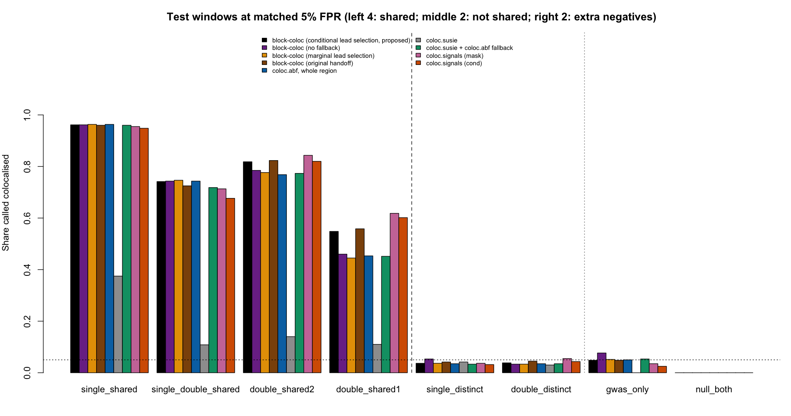
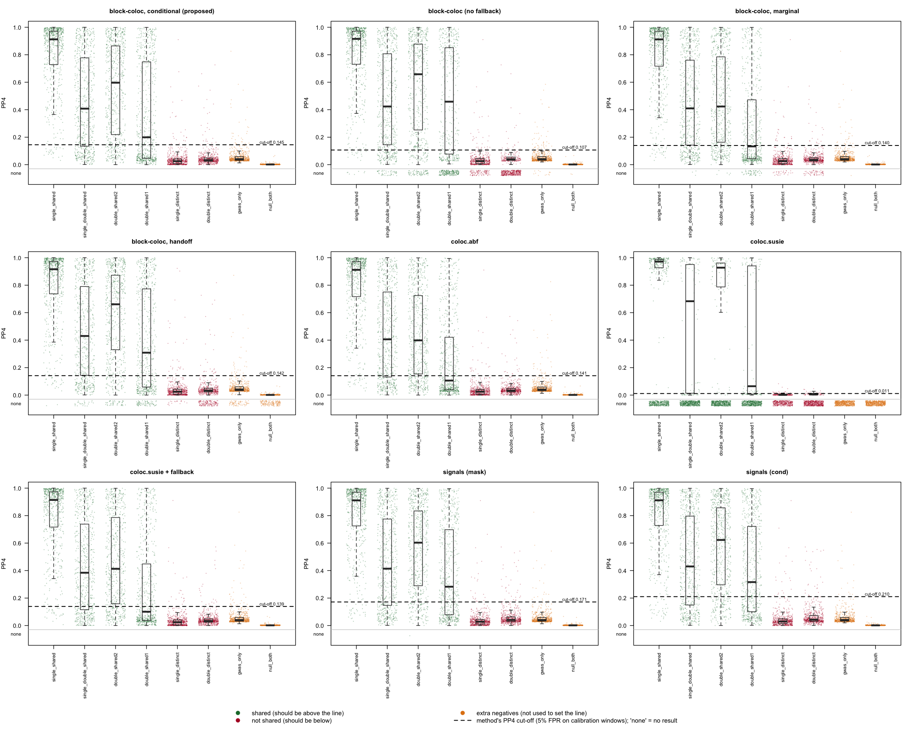
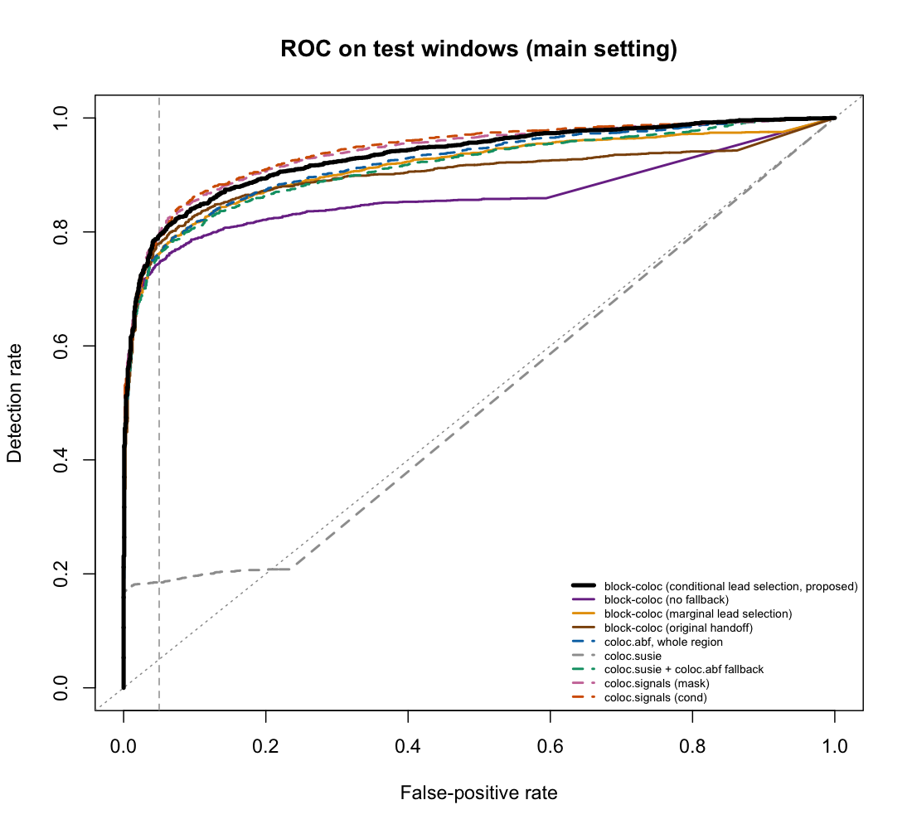
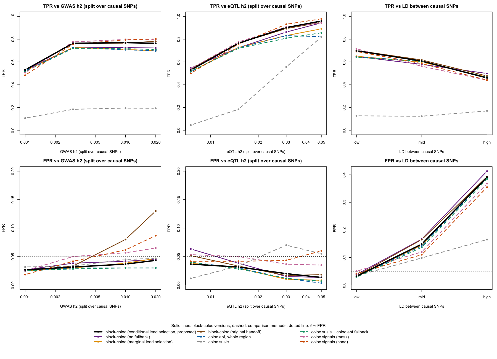

# Results

设定见 [Simulation](03_simulation.md)：$$h^2_1 = 0.003$$（$$N_1 = 20{,}000$$），$$h^2_2 = 0.015$$（$$N_2 = 1{,}000$$），区域遗传度按因果个数平分，因果间 $$\lvert r\rvert < 0.2$$，方法使用 1000 Genomes EUR 参考 LD。所有数字来自 6 个测试窗口，判定线在 6 个校准窗口上定为误报率 5%。第一段（2026-10-27，§1–§5）每个场景 600 个位点；第二段（2026-10-28，§6）从默认设定出发一次只改 $$h^2_1$$、$$h^2_2$$ 或因果间 LD，每个场景 300 个位点，沿用第一段的判定线。敏感性分析（2026-10-29，§7）把效应大小改为正态分布，重新定线；§8 比较块内先验与判定规则。完整表格：`outputs/bulk_h2ref_v1/RESULTS.md`、`RESULTS_grid.md`。

**block-coloc** 指本文方法：条件 lead 选择，且没有任何块同时含两性状的 lead（no valid block）时退回整区域 PP4（[Method](02_block_coloc_pseudocode.md) Step 5；2026-10-28 定为正式规则）。不含退回规则的版本（no valid block 记为无结果）记为“无 fallback”，作为敏感性分析报告。

## Summary

1. 误报率匹配到 5% 时，block-coloc 的合并检出率为 76.8%，比整区域 coloc.abf（73.2%）高 3.5 个百分点（95% CI +2.7 至 +4.4，McNemar $$p < 10^{-15}$$），比 coloc.susie + fallback（72.6%）高 4.2 个百分点，与 coloc.signals (cond)（76.2%；+0.6，$$p = 0.38$$）相当，低于 coloc.signals (mask)（78.2%；−1.5，$$p = 0.007$$）。
2. 默认设定下增益有限，原因是第二个 eQTL 信号很难检出：$$K_2 = 2$$ 时每个信号的期望 $$\lvert z\rvert = 2.75$$，eQTL 只有 15%–17% 的位点找到两个条件独立的 lead，切块大多由 GWAS 的两个 lead 触发；22.9% 的位点没有同时含两性状 lead 的块，退回整区域 PP4。不含退回规则时检出率为 73.8%，与 coloc.abf 无差别（+0.5，$$p = 0.5$$）。
3. double_shared1（两性状各有一个特有信号）是所有方法最难的场景（45%–62%）。误报率：single_distinct 3.7%、double_distinct 3.8%；只有 GWAS 有信号时（gwas_only）4.8%，与 coloc.abf（5.0%）相同；两性状都无信号时所有方法为 0。
4. **第二段**：block-coloc 相对整区域 coloc.abf 的优势随 eQTL 强度增大，在 $$h^2_2$$ = 1.5%、3%、5% 时分别高 4.0、7.1、13.7 个百分点（5% 时 95.9% 对 82.2%）。eQTL 找到两个 lead 的比例与 [Supplementary Note](09_parameters.md) 在运行前给出的预测一致（§5）。coloc.signals (cond) 在任一性状较强时检出率高 1.9–3.8 个百分点，但沿用第一段判定线时其误报率升到 6.0%–8.7%，block-coloc 不超过 4.3%（§6）。
5. 同一性状两个因果变异 $$\lvert r\rvert \ge 0.32$$ 时所有方法检出率下降，且 single_distinct 被判为共定位的比例升到 19%–29%（mid）和 70%–79%（high）：强 LD 中的不同因果变异在本样本量下不可区分（§6.4）。
6. **敏感性分析（正态效应）**：效应改为从 $$\mathcal{N}(0, h^2/K)$$ 抽取后，在相同误报率下 block-coloc 仍显著优于整区域 coloc.abf（默认强度 +1.9，$$h^2_2 = 5\%$$ 时 +5.5 个百分点，6 个测试窗口全部为正），与 coloc.signals 无差别；增益比固定效应小，因为第二个 eQTL 信号更少可检出（§7）。
7. **块内先验与判定规则**：把块内先验调到与整区域等价后，增益几乎全部保留（+3.0 / +7.7 个百分点），增益不是由块内先验造成的。用 traceCB 的固定规则（PP4 > 0.7 共定位，PP3 > 0.7 独立）时，block-coloc（每 SNP 先验）判出的共定位比 coloc.abf 多 7.5 和 24.1 个百分点，误报不增加；$$h^2_2 = 5\%$$ 时它是唯一对共定位与不共定位位点都给出明确结论的方法（§8）。

## 1. Power

测试窗口上判为共定位的比例（误报率在校准窗口上匹配到 5%）。

| 场景 $$(K_C, K_{S1}, K_{S2})$$ | **block-coloc** | 无 fallback | block-coloc 边际 | block-coloc 原版 | coloc.abf | coloc.susie + fb | signals (mask) | signals (cond) |
|---|---|---|---|---|---|---|---|---|
| single_shared (1, 0, 0) | 96.2 | 96.2 | 96.3 | 96.0 | 96.3 | 96.0 | 95.5 | 94.8 |
| single_double_shared (1, 0, 1) | 74.2 | 74.3 | 74.7 | 72.5 | 74.3 | 71.8 | 71.3 | 67.7 |
| double_shared2 (2, 0, 0) | 81.8 | 78.5 | 77.7 | 82.3 | 76.8 | 77.3 | **84.3** | 82.0 |
| double_shared1 (1, 1, 1) | 54.8 | 46.0 | 44.5 | 55.8 | 45.3 | 45.2 | **61.8** | 60.2 |
| 合并（2,400） | 76.8 | 73.8 | 73.3 | 76.7 | 73.2 | 72.6 | **78.2** | 76.2 |
| AUC | 0.934 | 0.864 | 0.914 | 0.900 | 0.922 | 0.914 | 0.940 | **0.943** |

单位：%。coloc.susie 单独使用（无 credible set 记为无结果）的合并检出率为 18.3%：eQTL 在 62%–89% 的位点上没有 credible set。

**Paired comparisons**（同一批 2,400 个阳性位点，McNemar 精确检验）：

| 比较 | 检出率差（百分点，95% CI） | $$p$$ |
|---|---|---|
| block-coloc − coloc.abf | +3.5 (+2.7, +4.4) | < 2e−16 |
| block-coloc − coloc.susie + fb | +4.2 (+3.2, +5.1) | < 2e−16 |
| block-coloc − signals (cond) | +0.6 (−0.6, +1.8) | 0.38 |
| block-coloc − signals (mask) | −1.5 (−2.6, −0.4) | 0.007 |
| 无 fallback − coloc.abf | +0.5 (−0.9, +2.0) | 0.5 |
| 无 fallback − signals (cond) | −2.4 (−4.0, −0.8) | 0.004 |
| signals (mask) − coloc.abf | +5.0 (+3.8, +6.3) | 1e−15 |

## 2. Type I error

同一组冻结判定线下的误报率（%）。gwas_only、null_both 不参与定线。

| 场景 | **block-coloc** | 无 fallback | block-coloc 边际 | block-coloc 原版 | coloc.abf | coloc.susie + fb | signals (mask) | signals (cond) |
|---|---|---|---|---|---|---|---|---|
| single_distinct (0, 1, 1) | 3.7 | 5.3 | 3.7 | 4.2 | 3.5 | 3.3 | 3.7 | 3.2 |
| double_distinct (0, 2, 2) | 3.8 | 3.3 | 3.3 | 4.5 | 3.5 | 3.5 | 5.5 | 4.3 |
| gwas_only (0, 1, 0) | 4.8 | 7.7 | 5.2 | 4.8 | 5.0 | 5.3 | 3.5 | 2.5 |
| null_both (0, 0, 0) | 0.0 | 0.0 | 0.0 | 0.0 | 0.0 | 0.0 | 0.0 | 0.0 |

校准窗口上的判定线（PP4）：coloc.abf 0.141，coloc.susie + fb 0.139，signals (mask) 0.171，signals (cond) 0.210，block-coloc 0.145，无 fallback 0.107。gwas_only 的 PP4 集中在 0.04–0.09（[Model](01_bulk_model.md) 式 5.3），判定线越低越容易越线：无 fallback 版本的 7.7% 来自较低的判定线，而不是切块（gwas_only 位点几乎都走整区域分支）。

## 3. Why the gain is small at the default setting

**Lead detection.** block-coloc（$$\alpha_{\mathrm{lead}} = 10^{-3}$$）找到的 lead 个数：

| 场景 | 走切块 | 性状 1 ≥ 2 个 lead | 性状 2 ≥ 2 个 lead | no valid block |
|---|---|---|---|---|
| single_shared | 15.5% | 9.8% | 8.2% | 1.2% |
| single_distinct | 18.0% | 12.3% | 8.2% | 17.3% |
| double_shared2 | 66.8% | 93.8% | 17.3% | 12.2% |
| double_shared1 | 68.5% | 93.8% | 15.5% | 35.5% |
| double_distinct | 65.8% | 94.5% | 16.8% | 63.8% |

- 性状 2 的第二个信号：由 [Model](01_bulk_model.md) 式 (4.5)，每个信号 $$\lambda = 2.75$$，因果 SNP 本身越过 $$p = 10^{-3}$$ 的概率为 29%；区域内（lead 取自因果及其 LD 代理）找到 lead 的概率约 50%（[Supplementary Note](09_parameters.md) Proposition 5）。按 Algorithm 1 在参考 LD 上的 Monte Carlo，找到两个条件独立 lead 的概率为 14.9%，与观察到的 15%–17% 一致（§5）。
- no valid block：性状 1 有 A、B 两个 lead，性状 2 只找到 1 个 lead，且它位于特有因果（double_shared1 的 C、double_distinct 的 C/D）附近时，两性状的 lead 邻域不相交。这些位点退回整区域 PP4；不含退回规则时，double_shared1 有 35.5% 无结果。
- 单信号位点上的切块（15.5%）主要来自较宽的 lead 阈值：同样规则在 $$\alpha_{\mathrm{lead}} = 10^{-4}$$ 时只有 1.5%。这与无信号时区域内出现假 lead 的概率一致（Proposition 4：$$10^{-3}$$ 时 13.4%，$$10^{-4}$$ 时 1.7%；§5）。两个阈值在校准窗口上的检出率相差 0.1 个百分点（73.9% 对 73.8%），按事先规则取 $$10^{-3}$$。

**Order of signals.** 共享变异不是较强信号时，所有基于 coloc.abf 的方法都明显变差：

| | coloc.abf | block-coloc | signals (mask) | signals (cond) |
|---|---|---|---|---|
| single_double_shared，共享信号在 eQTL 中较强 (n = 300) | 95.3 | 95.0 | 93.0 | 91.0 |
| single_double_shared，特有信号较强 (n = 300) | 53.3 | 53.3 | 49.7 | 44.3 |
| double_shared1，共享信号在两性状中都较弱 (n = 169) | 11.8 | 20.7 | 36.7 | 36.7 |

这与 Wallace (2020) 的结论一致：单次 coloc 检验的是最强信号，共享信号排在后面时会漏掉；条件或屏蔽后逐对检验能部分恢复。

## 4. Sensitivity

| 变体 | 判定线 | 检出率 | 误报率 | AUC | 无结果 |
|---|---|---|---|---|---|
| **block-coloc**（no valid block 退回整区域 PP4） | 0.145 | 76.8 | 3.8 | 0.934 | 0 |
| 无 fallback（no valid block 记为无结果） | 0.107 | 73.8 | 4.3 | 0.864 | 22.9% |
| 无 fallback，8 月阈值（$$5\times10^{-8}$$ / $$10^{-5}$$） | 0.141 | 73.2 | 3.4 | 0.919 | 1.0% |
| block-coloc 原版 + fallback | 0.159 | 77.3 | 4.6 | 0.934 | 0 |

**Localisation.** block-coloc 在 690 个走切块并检出的阳性位点上，选中的块 99.3% 包含共享因果，块的中位大小为 46 个 SNP；coloc.susie 的 credible set 对为 38 个 SNP。

## 5. Agreement with theory

[Supplementary Note](09_parameters.md) 中的理论值（Proposition 1 为闭式；Proposition 4、5 为参考 LD 上的 Monte Carlo，括号内为 Monte Carlo 标准误）与第一段的观察值（全部 12 个窗口；block-coloc，$$\alpha_{\mathrm{lead}} = 10^{-3}$$）：

| 量 | 理论 | 观察 |
|---|---|---|
| 因果变异的平均 $$\lvert z\rvert$$，性状 1，$$K_1 = 1$$ / 2（Prop. 1） | 7.76 / 5.48 | 7.79 / 5.48 |
| 同上，性状 2，$$K_2 = 1$$ / 2 | 3.90 / 2.75 | 3.92 / 2.72–2.77 |
| 无信号时有 ≥ 1 个 lead，$$10^{-3}$$（Prop. 4） | 13.4%（0.07） | 13.9% / 14.5%（null_both，性状 1 / 2） |
| 同上，$$10^{-4}$$ | 1.7%（0.03） | 1.4% / 2.1% |
| 单因果时有 ≥ 2 个 lead，$$10^{-3}$$（Prop. 4） | 略小于 13.4% | 9.5% / 6.9%（single_shared，性状 1 / 2） |
| 性状 2 单因果找到 lead，$$10^{-3}$$ / $$10^{-4}$$（Prop. 5，$$\lambda = 3.9$$） | 83.5% / 59.8%（0.2） | 83.8% / 60.6% |
| 性状 2 的 lead 邻域包含因果，给定找到（Prop. 5） | 89.0%（0.2） | 89.4%（1,006 个位点） |
| 双因果有 ≥ 2 个 lead，性状 1（$$\lambda = 5.48$$）（Prop. 5） | 93.9%（0.3） | 93.6%–93.8% |
| 同上，两个因果各被一个 lead 覆盖 | 89.2%（0.4） | 88.2%–88.7% |
| 双因果有 ≥ 2 个 lead，性状 2（$$\lambda = 2.75$$） | 14.9%（0.5） | 14.7%–17.6% |
| 同上，两个因果各被一个 lead 覆盖 | 8.0%（0.4） | 7.6%–9.4% |

双因果的观察值为相应场景的范围（性状 1：double_shared2、double_shared1、double_distinct；性状 2：另加 single_double_shared），每场景 1,200 个位点。理论值把参考 LD 同时当作真实 LD 和分析 LD；模拟中真实 LD 为样本内 LD，二者的差别（Model §7）在这些量上没有造成可见的偏差。

**Predictions for stage 2.** 同一 Monte Carlo 给出第二段中性状 2 双因果找到 ≥ 2 个 lead 的概率：$$h^2_2$$ = 0.0075、0.015、0.03、0.05 时分别为 4.0%、14.9%、56.2%、90.2%（两个因果各被覆盖：0.8%、8.0%、45.8%、83.6%）；性状 1 在 $$h^2_1$$ = 0.001、0.003、0.01、0.02 时为 28.1%、93.9%、98.6%、99.1%。第二段的观察值见下表。

| $$h^2_2$$ | 理论 $$\Pr(\lvert\mathcal{L}_2\rvert \ge 2)$$ | 观察（第二段，2,400 个位点） |
|---|---|---|
| 0.0075 | 4.0% | 4.0% |
| 0.015 | 14.9% | 15.9% |
| 0.03 | 56.2% | 55.9% |
| 0.05 | 90.2% | 89.3% |

| $$h^2_1$$ | 理论 $$\Pr(\lvert\mathcal{L}_1\rvert \ge 2)$$ | 观察（第二段，1,800 个位点） |
|---|---|---|
| 0.001 | 28.1% | 29.1% |
| 0.003 | 93.9% | 93.6% |
| 0.01 | 98.6% | 98.6% |
| 0.02 | 99.1% | 99.1% |

观察值为全部 12 个窗口、低 LD 档、相应性状有两个因果变异的位点（block-coloc，$$\alpha_{\mathrm{lead}} = 10^{-3}$$）。理论值是在运行第二段之前算出的。

## 6. Stage 2: one factor at a time

从默认设定（$$h^2_1 = 0.003$$，$$h^2_2 = 0.015$$，low LD）出发，一次只改一个因素；默认格使用第一段的前 50 次重复。每格测试窗口 1,200 个阳性位点（4 个阳性场景）、600 个阴性位点（single_distinct、double_distinct）；LD 档位的阳性为 3 个双因果场景，900 个位点。判定线沿用第一段（误报率在默认设定下为 5%），因此其他格的误报率会偏离 5%。配对比较与第一段相同（McNemar 精确检验，配对 Wald 区间）。代码：`scripts/grid_paired.py`；表格：`outputs/bulk_h2ref_v1/grid_paired.tsv`。

### 6.1 eQTL strength

检出率（括号内为误报率），%：

| $$h^2_2$$ | $$\lambda_2$$（$$K_2 = 2$$） | **block-coloc** | 无 fallback | coloc.abf | coloc.susie + fb | signals (mask) | signals (cond) |
|---|---|---|---|---|---|---|---|
| 0.0075 | 1.9 | 52.9 (3.7) | 54.7 (6.3) | 51.4 (4.0) | 51.9 (4.0) | 54.1 (5.3) | 50.0 (4.2) |
| 0.015 | 2.75 | 76.4 (3.2) | 72.5 (3.8) | 72.4 (3.0) | 71.9 (2.8) | 77.6 (5.0) | 75.7 (4.2) |
| 0.03 | 3.9 | 90.2 (2.0) | 86.2 (1.5) | 83.1 (1.2) | 80.8 (1.2) | 90.7 (3.7) | 93.1 (4.3) |
| 0.05 | 5.1 | 95.9 (1.3) | 94.3 (1.3) | 82.2 (0.3) | 85.6 (0.7) | 94.2 (3.5) | 97.8 (6.0) |

- 整区域 coloc.abf 在 $$h^2_2$$ 从 3% 增到 5% 时不升反降（83.1% → 82.2%）：两个 eQTL 信号都变强后，特有信号的 ABF 进入 $$H_3$$ 的分子（Model 式 5.3），单因果假设下的推断失效。
- block-coloc 的增益与 eQTL 找到两个条件独立 lead 的比例同步（§5：4% → 16% → 56% → 89%）；no valid block 的比例从 15.0% 降到 3.8%。
- coloc.susie 单独使用时检出率从 4.6% 升到 81.9%：eQTL 足够强时 SuSiE 才能给出 credible set。

### 6.2 GWAS strength

| $$h^2_1$$ | $$\lambda_1$$（$$K_1 = 1$$ / 2） | **block-coloc** | 无 fallback | coloc.abf | coloc.susie + fb | signals (mask) | signals (cond) |
|---|---|---|---|---|---|---|---|
| 0.001 | 4.5 / 3.2 | 53.0 (2.7) | 52.9 (2.7) | 52.2 (2.5) | 51.6 (2.5) | 50.7 (2.5) | 48.3 (1.8) |
| 0.003 | 7.8 / 5.5 | 76.4 (3.2) | 72.5 (3.8) | 72.4 (3.0) | 71.9 (2.8) | 77.6 (5.0) | 75.7 (4.2) |
| 0.01 | 14.2 / 10.0 | 76.9 (3.7) | 72.7 (4.2) | 70.8 (3.0) | 71.7 (3.0) | 79.8 (5.7) | 79.3 (6.2) |
| 0.02 | 20.2 / 14.2 | 76.4 (4.3) | 72.2 (4.5) | 69.8 (3.0) | 70.9 (3.0) | 79.7 (6.5) | 80.2 (8.7) |

- $$h^2_1 \ge 0.3\%$$ 后 block-coloc 的检出率不再增加：瓶颈在 eQTL（$$\lambda_2 = 2.75$$），GWAS 再强也找不到 eQTL 的第二个信号。
- coloc.signals 的误报率随 GWAS 强度上升（cond：4.2% → 8.7%）。这与 [Supplementary Note](09_parameters.md) Proposition 8 一致：$$\lambda_1 = 20$$ 时，参考 LD 与真实 LD 相差 0.16 就足以在条件化后产生假信号。block-coloc 的条件分析只用于计数 lead，不改变 coloc 的输入统计量，误报率保持在 4.5% 以下。

### 6.3 Paired comparisons

同一批阳性位点上的检出率差（百分点，95% CI）：

| 设定 | block-coloc − coloc.abf | block-coloc − signals (cond) | 无 fallback − coloc.abf |
|---|---|---|---|
| $$h^2_2 = 0.0075$$ | +1.5 (+0.5, +2.5)，$$p = 0.004$$ | +2.9 (+0.9, +4.9)，$$p = 0.005$$ | +3.2 (+1.3, +5.2)，$$p = 0.002$$ |
| 默认 | +4.0 (+2.7, +5.3)，$$p < 10^{-9}$$ | +0.8 (−1.0, +2.5)，$$p = 0.45$$ | +0.1 (−2.0, +2.2)，$$p = 1$$ |
| $$h^2_2 = 0.03$$ | +7.1 (+5.6, +8.6)，$$p < 10^{-20}$$ | −2.9 (−4.3, −1.6)，$$p < 10^{-4}$$ | +3.2 (+1.1, +5.3)，$$p = 0.004$$ |
| $$h^2_2 = 0.05$$ | +13.7 (+11.7, +15.6)，$$p < 10^{-40}$$ | −1.9 (−2.8, −1.0)，$$p < 10^{-4}$$ | +12.1 (+10.0, +14.2)，$$p < 10^{-28}$$ |
| $$h^2_1 = 0.001$$ | +0.8 (+0.2, +1.5)，$$p = 0.02$$ | +4.7 (+3.3, +6.0)，$$p < 10^{-10}$$ | +0.8 (−0.9, +2.4)，$$p = 0.43$$ |
| $$h^2_1 = 0.01$$ | +6.2 (+4.8, +7.6)，$$p < 10^{-19}$$ | −2.4 (−4.3, −0.5)，$$p = 0.015$$ | +1.9 (−0.3, +4.2)，$$p = 0.11$$ |
| $$h^2_1 = 0.02$$ | +6.7 (+5.2, +8.1)，$$p < 10^{-20}$$ | −3.8 (−5.7, −1.9)，$$p < 10^{-3}$$ | +2.5 (+0.2, +4.8)，$$p = 0.04$$ |
| mid LD | +0.2 (−0.6, +1.1)，$$p = 0.80$$ | +2.2 (−0.1, +4.5)，$$p = 0.07$$ | −2.7 (−4.9, −0.4)，$$p = 0.03$$ |
| high LD | −0.6 (−1.2, +0.1)，$$p = 0.18$$ | +1.9 (−0.0, +3.8)，$$p = 0.07$$ | +3.3 (+1.7, +5.0)，$$p < 10^{-3}$$ |

block-coloc 在 9 个设定中 7 个显著高于整区域 coloc.abf，其余 2 个（mid、high LD）无差别。与 coloc.signals (cond) 相比，弱信号时更好，任一性状较强时低 1.9–3.8 个百分点；后者在这些格的误报率为 4.3%–8.7%，高于 block-coloc 的 1.3%–4.3%，两者不是在相同误报率下比较。

### 6.4 LD between causal variants

| 档位 | **block-coloc** | 无 fallback | coloc.abf | signals (mask) | signals (cond) | single_distinct 判为共定位（coloc.abf） | 走切块（double_shared2） |
|---|---|---|---|---|---|---|---|
| low（$$\lvert r\rvert < 0.2$$） | 69.9 (3.2) | 64.8 (3.8) | 64.6 (3.0) | 71.6 (5.0) | 69.2 (4.2) | 2.3 | 70.3 |
| mid（0.32–0.63） | 60.8 (14.8) | 57.9 (16.7) | 60.6 (14.2) | 56.2 (12.0) | 58.6 (11.0) | 25.0 | 38.0 |
| high（0.63–0.9） | 46.0 (39.2) | 49.9 (41.3) | 46.6 (39.0) | 44.0 (36.8) | 44.1 (35.5) | 75.3 | 17.0 |

（检出率合并 single_double_shared、double_shared2、double_shared1；括号内误报率合并 single_distinct、double_distinct。）

- 误报率的上升几乎全部来自 single_distinct：性状 1 的因果 A 与性状 2 的因果 B 之间 $$\lvert r\rvert \ge 0.63$$ 时，A 处的边际 $$z$$ 有 $$\lvert r\rvert\lambda$$ 来自 B，所有基于单 SNP 贝叶斯因子的方法都无法区分 A 与 B（Wallace 2021 与 Hukku et al. 2021 也指出强 LD 中的不同因果变异无法分辨）。coloc.susie 单独使用时为 31%，同样很高。
- 切块比例随 LD 升高而下降，与 Proposition 3 一致：同号时第二个信号的条件强度降为 $$\lambda\sqrt{1 - \lvert r\rvert}$$，异号时两个边际信号互相抵消；中位 lead 数从 2 + 1 变为 1 + 1。

### 6.5 Extra negatives

gwas_only 中，block-coloc 的误报率为 3.3%–5.3%，与整区域 coloc.abf（3.3%–5.3%）相同；无 fallback 版本为 4.7%–9.3%。gwas_only 位点几乎都走整区域分支（默认设定下走切块的只有 1.3%），差别来自判定线：无 fallback 版本的判定线为 0.107，block-coloc 为 0.145，coloc.abf 为 0.141，而 gwas_only 的 PP4 集中在 0.04–0.09（§2）。null_both 所有方法误报为 0。

方法错误：第二段 278,400 条评分中有 8 条记为无结果（coloc.signals (mask) 6 条 `'by' must specify a uniquely valid column`，(cond) 2 条矩阵奇异），不影响结论。

## 7. Sensitivity: normal effect sizes

主设计中每个因果变异的效应大小固定为 $$\sqrt{h^2/K}$$。这里改为与 traceCB 相同的 $$\beta \sim \mathcal{N}(0, h^2/K)$$（两性状独立抽取，不缩放，$$\operatorname{Var}(g)$$ 只在期望上等于 $$h^2$$；[Supplementary Note](09_parameters.md) Proposition 2）。因果变异、符号和残差与主设计相同，只有效应大小不同。判定线和 lead 阈值在本设计自己的校准窗口上重新选（误报率 5%），因此本节的比较都在相同误报率下进行。两格：默认强度（100 次重复）与 $$h^2_2 = 5\%$$（50 次重复）。代码：`run.R --effect normal`；结果：`outputs/bulk_h2ref_v1_normal*/RESULTS.md`。

检出率（括号内为测试窗口误报率），%：

| 设定 | 效应 | block-coloc | 无 fallback | coloc.abf | coloc.susie + fb | signals (mask) | signals (cond) |
|---|---|---|---|---|---|---|---|
| 默认（$$h^2_2 = 1.5\%$$） | 固定（第一段） | 76.8 (3.8) | 73.8 (4.3) | 73.2 (3.5) | 72.6 (3.4) | 78.2 (4.6) | 76.2 (3.8) |
| | 正态 | 39.7 (6.2) | 38.2 (5.5) | 37.8 (6.1) | 38.2 (5.8) | 39.5 (6.0) | 39.2 (6.0) |
| $$h^2_2 = 5\%$$ | 正态 | 51.7 (7.3) | 50.0 (7.0) | 46.2 (7.0) | 48.8 (7.5) | 51.3 (7.5) | 50.9 (7.2) |

配对比较（同一批阳性位点，百分点，95% CI）：

| 设定 | block-coloc − coloc.abf | block-coloc − signals (cond) | block-coloc − signals (mask) | 6 个测试窗口中增益 > 0 |
|---|---|---|---|---|
| 正态，默认 | +1.9 (+1.3, +2.5)，$$p = 2\times10^{-11}$$ | +0.5，$$p = 0.36$$ | +0.2，$$p = 0.59$$ | 6 / 6（+0.5 至 +3.8） |
| 正态，$$h^2_2 = 5\%$$ | +5.5 (+4.2, +6.8)，$$p < 10^{-15}$$ | +0.8，$$p = 0.42$$ | +0.3，$$p = 0.74$$ | 6 / 6（+4.0 至 +7.0） |

AUC：正态默认 block-coloc 0.708、coloc.abf 0.698、signals 0.690–0.696；正态 $$h^2_2 = 5\%$$ block-coloc 0.786、coloc.abf 0.755、signals 0.750–0.763。

- **结论的方向不变，幅度变小.** block-coloc 在两格都显著优于整区域 coloc.abf，与 coloc.signals 无差别。固定效应下 $$h^2_2 = 5\%$$ 的增益为 +13.7 个百分点（§6，沿用第一段判定线），正态效应下为 +5.5。
- **机制.** 正态效应下两个因果变异常常一强一弱：默认强度下 eQTL 因果变异的 $$\lvert z\rvert$$ 有 36%（单因果）至 50%（双因果）低于 2。两因果的 eQTL 找到两个条件独立 lead 的比例在默认强度下为 11.4%（固定效应 15.9%），在 $$h^2_2 = 5\%$$ 时为 31.1%（固定效应 89.3%）。block-coloc 只在第二个信号可检出的位点上与 coloc.abf 不同，所以增益随这一比例缩小。
- **所有方法整体变低**（默认强度下 38%–40%，固定效应 73%–77%），因为相当一部分共享因果变异在某个性状中的效应接近 0。这些位点在数据上与“不共定位”无法区分，任何方法都检不出。
- **测试窗口的误报率高于 5%**（6%–9%，所有方法相近）：判定线在 6 个校准窗口上定，正态效应下校准与测试窗口之间的差异更大。方法间比较不受影响，因为所有方法用同样的窗口划分。
- **gwas_only.** $$h^2_2 = 5\%$$ 时，block-coloc 与整区域 coloc.abf 的 gwas_only 误报率为 11.7% 与 12.0%，coloc.signals 为 2.7%–4.3%：该设计的判定线（0.070）低于只有 GWAS 信号时 PP4 的典型值（约 0.09，[Model](01_bulk_model.md) 式 5.3）。这是用 single_distinct、double_distinct 定线时所有基于整区域 coloc.abf 的方法共有的问题，不是 block-coloc 特有的。
- lead 阈值按本文方法（含 fallback）的校准检出率选择：两格均为 $$10^{-3}$$。

## 8. Block priors and decision rules

**Question.** coloc 的先验按 SNP 给出。一个含 $$M_B$$ 个 SNP 的块中，先验比 $$H_4 : H_3 = p_{12}/\{(M_B-1)p_1p_2\}$$：块中位 42 个 SNP 时约 24，整区域（约 940 个 SNP）约 1（[Supplementary Note](09_parameters.md) Proposition 7）。因此 block-coloc 的 PP4 有一部分可能来自“块小”而不是数据。另一方面，真实数据没有真值，无法按误报率定线，需要一条固定的判定规则。本节在与第一段完全相同的位点上（同一组随机数；与第一段逐位点核对，PP4 差异为 0），比较两种块内先验与两种判定规则：

- **块内先验**：每 SNP 先验（第一、二段的做法）；区域等价先验：块内 $$p_1, p_2, p_{12}$$ 都乘以 $$M/M_B$$，使块内 $$H_0$$–$$H_4$$ 的先验概率与整区域相同。
- **判定规则**：误报率在校准窗口上匹配到 5%（同前）；traceCB（Jiang et al. 2026）的固定规则：PP4 > 0.7 判为共定位，PP3 > 0.7 判为独立，其余为不确定。

两格：默认强度（100 次重复）与 $$h^2_2 = 5\%$$（50 次重复），固定效应，低 LD。block-coloc 都含 fallback。代码：`scripts/prior_rule.R`、`prior_rule_eval.py`；结果：`outputs/bulk_h2ref_v1_prior*/PRIOR_RULE.md`。

### 8.1 Matched false-positive rate

检出率（括号内为测试窗口误报率），%：

| 设定 | coloc.abf | block-coloc，每 SNP 先验 | block-coloc，区域等价先验 | signals (mask) | signals (cond) |
|---|---|---|---|---|---|
| 默认 | 73.2 (3.5) | 76.8 (3.8) | 76.2 (3.6) | 78.2 (4.6) | 76.2 (3.8) |
| $$h^2_2 = 5\%$$ | 89.8 (5.0) | 97.7 (6.8) | 97.5 (6.7) | 94.8 (6.2) | 98.2 (7.5) |

配对比较（百分点，95% CI）：

| 设定 | 区域等价先验 − coloc.abf | 每 SNP 先验 − coloc.abf | 区域等价 − 每 SNP 先验 |
|---|---|---|---|
| 默认 | +3.0 (+2.2, +3.9)，$$p = 2\times10^{-12}$$ | +3.5 (+2.7, +4.4) | −0.5 (−0.9, −0.1)，$$p = 0.02$$ |
| $$h^2_2 = 5\%$$ | +7.7 (+6.1, +9.2)，$$p = 10^{-24}$$ | +7.8 (+6.3, +9.4) | −0.2 (−0.4, +0.1)，$$p = 0.5$$ |

**块内先验调到与整区域等价后，增益几乎全部保留**（默认格 3.5 中保留 3.0，$$h^2_2 = 5\%$$ 格 7.8 中保留 7.7）：block-coloc 的增益主要来自数据，不是来自块内先验。$$h^2_2 = 5\%$$ 格在本格内重新定线（与 §6 沿用第一段判定线不同），所以增益与 §6 的 +13.7 不可直接比较。

### 8.2 traceCB rule

测试窗口中各类位点的判定结果，%：

| 设定 | 方法 | 共定位位点：判共定位 / 判独立 / 不确定 | single_distinct：判独立（判共定位） | double_distinct：判独立（判共定位） | gwas_only：判共定位 |
|---|---|---|---|---|---|
| 默认 | coloc.abf | 36.5 / 4.1 / 59.3 | 35.7 (0.2) | 10.2 (0.0) | 0.2 |
| | block-coloc，每 SNP 先验 | **44.1** / 2.7 / 53.2 | 35.5 (0.2) | 9.8 (0.2) | 0.2 |
| | block-coloc，区域等价先验 | 26.9 / 3.9 / 69.2 | 35.5 (0.2) | 10.3 (0.0) | 0.2 |
| | signals (mask) | 42.6 / 2.1 / 55.3 | 27.0 (0.2) | 4.7 (0.0) | 0.2 |
| | signals (cond) | 44.9 / 1.5 / 53.7 | 21.2 (0.3) | 2.5 (0.0) | 0.2 |
| $$h^2_2 = 5\%$$ | coloc.abf | 68.2 / 20.4 / 11.3 | 100 (0.0) | 90.0 (0.0) | 0.0 |
| | block-coloc，每 SNP 先验 | **92.3** / 4.8 / 2.8 | **98.3** (0.3) | **88.0** (0.0) | 0.0 |
| | block-coloc，区域等价先验 | 49.8 / 6.8 / 43.4 | 98.3 (0.0) | 88.7 (0.0) | 0.0 |
| | signals (mask) | 86.8 / 5.4 / 7.8 | 70.7 (0.3) | 34.3 (0.0) | 0.0 |
| | signals (cond) | 92.8 / 1.3 / 5.9 | 47.7 (1.3) | 19.0 (1.0) | 0.0 |

- **每 SNP 先验的 block-coloc 在固定规则下没有增加误报**：不共定位位点被判为共定位的比例 ≤ 0.3%，与 coloc.abf 相同；gwas_only 为 0%–0.2%。同一批共定位位点上，它比 coloc.abf 多判出 7.5（默认，$$p = 10^{-48}$$）和 24.1（$$h^2_2 = 5\%$$，$$p = 10^{-85}$$）个百分点。
- **$$h^2_2 = 5\%$$ 时，只有 block-coloc 在两类位点上都给出明确结论**：共定位位点 92.3% 判为共定位，single_distinct 98.3% 判为独立。coloc.abf 漏判较多，且把 20.4% 的共定位位点错判为独立；coloc.signals 对共定位位点判得同样准，但对不共定位位点多数给出“不确定”（cond 51%、mask 29%）。
- **区域等价先验矫枉过正.** 先验调整把整区域 $$H_3$$ 的全部先验质量集中到块内的 SNP 对上（每对的先验乘以 $$(M/M_B)^2$$，约 500）；而块内的 SNP 彼此都是同一信号的代理，两个性状的 ABF 在任意两个不同代理上的乘积都很大。于是块内的 $$H_3$$ 被抬高，块内 PP4 中位数从 0.87 降到 0.55（$$h^2_2 = 5\%$$：0.98 降到 0.66），低于同一批位点整区域 coloc.abf 的 0.72（0.88）。这种先验并不中性，只是把偏差换了方向。

### 8.3 Implications

1. 块内采用每 SNP 先验（[Method](02_block_coloc_pseudocode.md) §4）；区域等价先验作为敏感性分析报告，用来说明增益不是由块内先验造成的。
2. 真实数据中采用 traceCB 的三分类规则（PP4 > 0.7 / PP3 > 0.7），与组内已有工作口径一致。
3. **按误报率匹配定线有盲区**：$$h^2_2 = 5\%$$ 时不共定位位点的 PP4 几乎为 0，定出的判定线只有 0.012–0.014，只有 GWAS 有信号的位点（PP4 约 0.09，[Model](01_bulk_model.md) 式 5.3）在 coloc.abf 和 block-coloc 下全部越线（100%）；固定规则下为 0%。按误报率匹配仍是比较方法的标准，但其判定线不宜直接用于真实数据。
4. **局限**：固定规则的比较只在两格、固定效应、因果变异间 $$\lvert r\rvert < 0.2$$ 的阴性位点上做过；高 LD 阴性（§6.4）下固定规则的误报尚未检验。

## 9. Notes

- 每个场景 600 个阳性位点，检出率约 75% 时标准误约 1.8 个百分点；方法间 2–3 个百分点的差异需看配对检验。
- 1 个位点上 coloc.signals (mask) 报 coloc 内部错误（`'by' must specify a uniquely valid column`），记为无结果。
- 只有基因型和 LD 是真实的，结果不对应任何真实基因或疾病。
- 上一版设定（每个因果变异固定解释比例、方法使用样本内 LD）的结果见 [Previous results](07_results_v1.md)。
