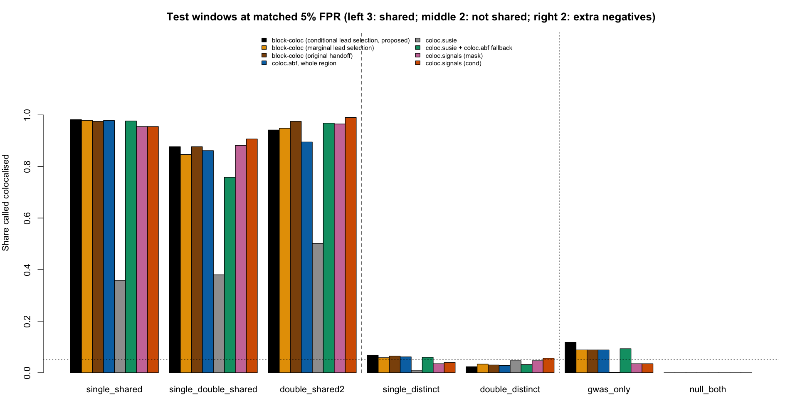
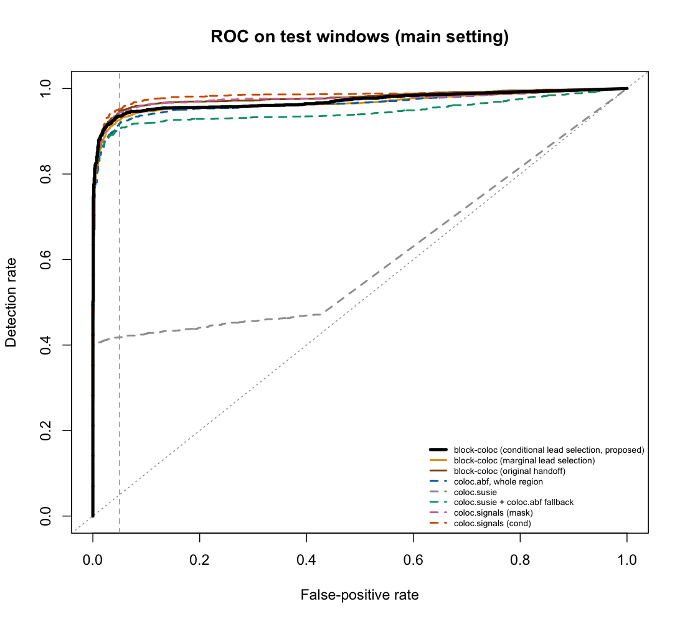
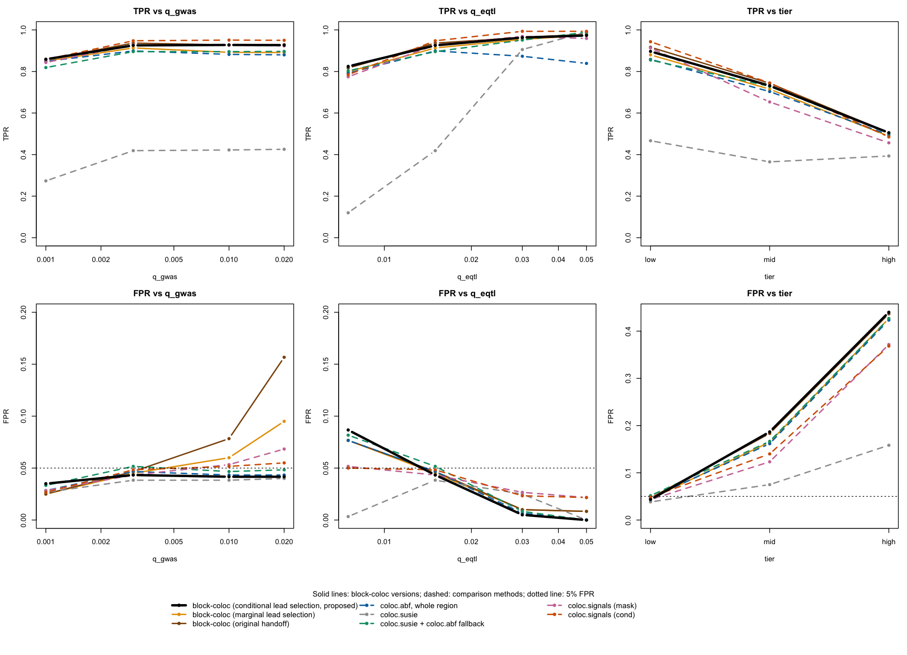

# 4. 结果

> 第一段（主设置）和第二段（一次只变一个因素）均已完成（2026-10-26）。
> 本页只摘要；完整表格见本仓库的 `results/stage1/RESULTS.md` 和 `results/stage2/RESULTS_grid.md`。

## 4.1 评价规则（事先定好，不看结果调整）

- 每个方法的分数是 PP4；无结果计为“未判为共定位”，并单独报告无结果率。分母始终是全部位点。
- **固定误报率比较**：每个方法在 6 个校准窗口上定出一条 PP4 判定线，使不共定位场景（single_distinct、double_distinct）的误报率为 5%。
- block-coloc 各版本的 lead 阈值（1e-3 / 1e-4 / 1e-5）也只在校准窗口上选。
- 判定线冻结后，在另外 6 个测试窗口上报告：检出率、误报率、AUC、无结果率、走 block 分支的比例、是否正确判断要不要切块，以及与 `susie_fallback`、`whole_abf` 在同一批位点上的配对比较（McNemar 检验）。
- **额外阴性** gwas_only（只有 GWAS 有信号）、null_both（两个性状都没有信号）：用同一条冻结的判定线报告误报率，不参与定判定线，也不并入总的检出率、误报率和 AUC。
- 第二段沿用第一段的判定线和 lead 阈值，不重新调。
- 区间：比例用 Wilson 95% 置信区间；AUC 用 1,000 次 bootstrap。

## 4.2 第一段：主设置

设定：GWAS q 0.3%（N 20,000）、eQTL q 1.5%（N 1,000）、因果间 |r| < 0.2；12 窗口 × 7 场景 × 100 次重复。
lead 阈值在校准窗口上选出：block-coloc（条件 lead 选择）为 1e-4，block-coloc（边际 lead 选择）和 block-coloc（交接包原版）为 1e-5。

### 三行结论

1. **检出率**：误报率在校准窗口上匹配到 5%（测试窗口实际为 4.1%–4.8%，coloc.susie 为 2.8%）时，block-coloc（条件 lead 选择，本文方法）检出 93.3% 的共定位位点，高于整区域 coloc.abf 的 91.2%（同一批位点配对差 +2.2 个百分点，95% CI +1.1 至 +3.2）和 coloc.susie + coloc.abf fallback 的 90.1%（+3.2，+2.1 至 +4.4）。提升主要来自 double_shared2（94.2% 对 89.5%），single_shared 上没有损失（98.2% 对 97.8%）。但它没有超过 coloc.signals (cond)（95.1%），与 block-coloc（交接包原版，94.2%）也相近。
2. **是否切块**：条件 lead 选择基本消除了单信号位点被误切块：在 single_shared、single_distinct 上走 block 的比例为 1.5% 和 0.3%；边际 lead 选择为 3.7% 和 4.3%；交接包原版在 single_shared 上为 84.8%。但多信号常被漏判：single_double_shared 只有 26.0% 走 block，double_shared2 为 78.8%，因为 eQTL 的第二个信号（N = 1,000，因果 |z| ≈ 3.9）经常过不了 lead 阈值。single_double_shared 中当 eQTL 特有的信号比共享信号更显著时，所有方法检出率都明显下降（整区域 coloc.abf 73.0%，block-coloc（条件 lead 选择）76.2%，coloc.susie + fallback 54.7%）。
3. **只有一个性状有信号时的误报**（额外阴性，未用于定判定线）：gwas_only 上，基于 coloc.abf 的方法误报 8.8%–11.8%，超过目标 5%；block-coloc（条件 lead 选择）为 11.8%，略高于整区域 coloc.abf 的 8.8%，原因是它的判定线更低（0.094 对 0.109），这些位点上两者给出的 PP4 在 600 个中有 599 个完全相同。coloc.signals 为 3.5%，coloc.susie 为 0.2%；null_both 上所有方法均为 0%。

### 汇总（测试窗口）

| 方法 | 检出率 | 误报率 | AUC |
|---|---|---|---|
| **block-coloc（条件 lead 选择，本文方法）** | **93.3%** | 4.6% | 0.971 |
| block-coloc（边际 lead 选择） | 92.4% | 4.6% | 0.966 |
| block-coloc（交接包原版） | 94.2% | 4.8% | 0.977 |
| 整区域 coloc.abf | 91.2% | 4.5% | 0.964 |
| coloc.susie (raw) | 41.3% | 2.8% | 0.610 |
| coloc.susie + fallback | 90.1% | 4.6% | 0.946 |
| coloc.signals (mask) | 93.4% | 4.1% | 0.974 |
| coloc.signals (cond) | 95.1% | 4.8% | 0.983 |

| 场景 | block-coloc（条件 lead 选择） | coloc.abf | coloc.susie + fallback | coloc.signals (cond) |
|---|---|---|---|---|
| single_shared | 98.2% | 97.8% | 97.7% | 95.5% |
| single_double_shared | 87.7% | 86.2% | 75.8% | 90.7% |
| double_shared2 | 94.2% | 89.5% | 96.8% | 99.0% |
| single_distinct（误报） | 6.8% | 6.2% | 6.0% | 4.0% |
| double_distinct（误报） | 2.3% | 2.8% | 3.2% | 5.7% |
| gwas_only（误报，额外阴性） | 11.8% | 8.8% | 9.3% | 3.5% |
| null_both（误报，额外阴性） | 0.0% | 0.0% | 0.0% | 0.0% |

左边 3 组是共定位场景（越高越好），中间 2 组是不共定位场景，右边 2 组是额外阴性（越低越好），虚线是 5% 误报率。

### 读结果时要注意

- 测试窗口只有 6 个，各方法之间 2–3 个百分点的差距虽然配对检验显著，但幅度不大。
- 只有基因型和 LD 是真实的，结果不对应任何真实基因或疾病。

## 4.3 第二段：一次只变一个因素

从主设置出发，每次只改一个：GWAS q（0.1%、0.3%、1%、2%）、eQTL q（0.75%、1.5%、3%、5%）、不同因果变异之间的 LD 档位（|r| < 0.2、0.32–0.63、0.63–0.9）。每格 50 次重复，测试窗口每格每场景 300 个位点。

### 三行结论

1. **GWAS 变强时，条件 lead 选择能把误报率稳住**：GWAS q 从 0.1% 增大到 2% 时，block-coloc（条件 lead 选择）的误报率保持在 3.5%–4.3%，而 block-coloc（边际 lead 选择）升到 9.5%、block-coloc（交接包原版）升到 15.7%；整区域 coloc.abf 保持在 4.3%。q = 2% 时它的检出率为 92.7%，高于整区域 coloc.abf（88.0%）和 coloc.susie + fallback（89.7%），低于 coloc.signals (cond)（95.0%）。
2. **eQTL 弱时它最好，eQTL 强时被反超**：eQTL q = 0.75% 时，block-coloc（条件 lead 选择）检出率最高（82.4%；coloc.susie + fallback 80.3%，整区域 coloc.abf 79.2%，coloc.signals (cond) 78.4%）；eQTL q = 5% 时，coloc.signals (cond)（99.3%）和 coloc.susie + fallback（98.9%）超过它（97.3%），整区域 coloc.abf 反而降到 83.9%。
3. **局限**：不同因果变异之间的 LD 升高时，所有方法都明显变差：检出率从约 90%（|r| < 0.2）降到约 50%（|r| 0.63–0.9）；高 LD 时 single_distinct 被 block-coloc（条件 lead 选择）判为共定位的比例达 84.3%（coloc.susie 为 31.0%）。只有 GWAS 有信号时（gwas_only），基于 coloc.abf 的方法误报 4%–17%，block-coloc（条件 lead 选择）为 6.3%–13.3%，coloc.signals 为 1.3%–4.7%，coloc.susie 为 0%；两性状都没有信号时，所有方法误报均为 0%。

### GWAS 强度（eQTL q 1.5%，低 LD）：检出率 / 误报率

| GWAS q | block-coloc（条件） | block-coloc（边际） | block-coloc（交接包原版） | coloc.abf | coloc.susie + fallback | coloc.signals (cond) |
|---|---|---|---|---|---|---|
| 0.1% | 85.9% / 3.5% | 85.0% / 2.5% | 85.7% / 2.5% | 84.9% / 2.8% | 81.9% / 3.3% | 85.8% / 2.7% |
| 0.3% | 92.6% / 4.3% | 91.3% / 4.5% | 93.7% / 4.7% | 89.9% / 4.7% | 89.6% / 5.2% | 94.8% / 4.8% |
| 1% | 92.8% / 4.2% | 89.2% / 6.0% | 92.8% / 7.8% | 88.2% / 4.3% | 89.6% / 4.7% | 95.1% / 5.2% |
| 2% | 92.7% / 4.2% | 89.1% / 9.5% | 92.9% / 15.7% | 88.0% / 4.3% | 89.7% / 4.8% | 95.0% / 5.5% |

### eQTL 强度（GWAS q 0.3%，低 LD）：检出率 / 误报率

| eQTL q | block-coloc（条件） | block-coloc（边际） | block-coloc（交接包原版） | coloc.abf | coloc.susie + fallback | coloc.signals (cond) |
|---|---|---|---|---|---|---|
| 0.75% | 82.4% / 8.7% | 79.9% / 7.7% | 81.7% / 7.7% | 79.2% / 7.7% | 80.3% / 8.2% | 78.4% / 5.0% |
| 1.5% | 92.6% / 4.3% | 91.3% / 4.5% | 93.7% / 4.7% | 89.9% / 4.7% | 89.6% / 5.2% | 94.8% / 4.8% |
| 3% | 96.3% / 0.5% | 95.4% / 1.0% | 96.3% / 1.0% | 87.3% / 0.7% | 95.1% / 0.8% | 99.3% / 2.3% |
| 5% | 97.3% / 0.0% | 97.4% / 0.8% | 97.9% / 0.8% | 83.9% / 0.0% | 98.9% / 0.0% | 99.3% / 2.2% |

### 不同因果变异之间的 LD（主强度）：检出率 / 误报率

检出率合并 single_double_shared、double_shared2；误报率合并 single_distinct、double_distinct（single_shared 没有成对因果，不参与）。

| 因果间 \|r\| | block-coloc（条件） | block-coloc（边际） | block-coloc（交接包原版） | coloc.abf | coloc.susie | coloc.susie + fallback | coloc.signals (cond) |
|---|---|---|---|---|---|---|---|
| < 0.2 | 89.7% / 4.3% | 88.0% / 4.5% | 91.7% / 4.7% | 85.8% / 4.7% | 46.7% / 3.8% | 85.5% / 5.2% | 94.3% / 4.8% |
| 0.32–0.63 | 73.2% / 18.7% | 71.5% / 16.5% | 74.3% / 18.3% | 70.3% / 16.2% | 36.5% / 7.5% | 72.8% / 16.7% | 74.5% / 14.0% |
| 0.63–0.9 | 50.5% / 44.0% | 48.8% / 42.7% | 50.5% / 43.7% | 49.5% / 42.3% | 39.3% / 15.8% | 50.2% / 42.7% | 48.5% / 36.8% |

LD 较高时误报主要来自 single_distinct：两个不同的因果变异高度连锁，几乎无法和“共享同一个因果变异”区分（高 LD 档下 block-coloc（条件）84.3%，coloc.susie 31.0%）。

### 只有 GWAS 有信号时的误报率（gwas_only，额外阴性）

| GWAS q | block-coloc（条件） | block-coloc（边际） | block-coloc（交接包原版） | coloc.abf | coloc.susie | coloc.susie + fallback | coloc.signals (cond) |
|---|---|---|---|---|---|---|---|
| 0.1% | 6.3% | 4.0% | 4.3% | 4.3% | 0.0% | 4.3% | 1.3% |
| 0.3% | 13.3% | 10.0% | 10.7% | 10.0% | 0.0% | 11.0% | 4.0% |
| 1% | 13.0% | 10.3% | 12.3% | 10.3% | 0.0% | 11.3% | 4.3% |
| 2% | 13.0% | 10.3% | 17.0% | 10.7% | 0.0% | 11.3% | 4.7% |

GWAS q ≥ 0.3% 后，多数方法的误报率不再随 GWAS 变强而上升；交接包原版是例外，从 10.7% 升到 17.0%。gwas_only 的误报率与 eQTL 强度无关（eQTL 没有因果变异）；null_both 上所有方法均为 0%。

黑色粗线是 block-coloc（条件 lead 选择）。

### 读结果时要注意

- 第二段沿用第一段在主设置上定的判定线；强度变化后，误报率会偏离 5%（例如 eQTL q = 0.75% 时约 8%），这是有意为之，用来看同一条判定线在不同条件下是否稳健。
- 第二段有 8 个 coloc.signals (mask) 的运行错误（来自 coloc 包内部，均在校准窗口 42313324），按规则计为无结果；它们不在测试窗口，不影响本页任何数字。
