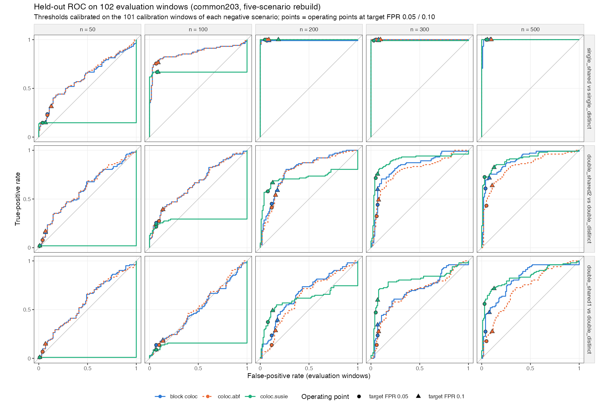
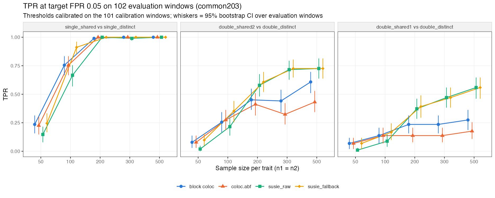
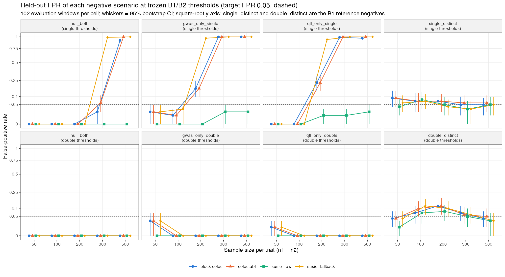

# 5. 早期 bulk 结果（2026 年 10 月中）

> **注意：这一页的设定和第 4 页不同，数字不能直接和第 4 页比较。**
> 这是 10 月 12–13 日按 8 月旧 bulk 设定重建的一批结果，只评估了 block-coloc（交接包原版），没有条件 / 边际 lead 选择两个新版本。
> 图中的 “block coloc” 指 block-coloc（交接包原版）；“susie_raw” 即 coloc.susie，“susie_fallback” 即 coloc.susie + coloc.abf fallback。

## 5.1 设定：和当前（第 4 页）有什么不同

| | 早期（10 月中） | 当前（第 4 页） |
|---|---|---|
| 窗口 | 203 个 LD 近似独立的窗口（每个 ≥ 50 个 SNP）：101 个校准、102 个评价 | 12 个约 1 Mb 窗口：6 个校准、6 个测试 |
| 样本量 | 两个性状相同，n = 50、100、200、300、500 | GWAS 20,000，eQTL 1,000 |
| 效应强度 | 每个性状 h² = 0.2（两个因果变异时各 0.1） | 每个因果变异 q：GWAS 0.3%，eQTL 1.5% |
| 场景 | single_shared、single_distinct、double_shared1、double_shared2、double_distinct | single_shared、single_double_shared、double_shared2、single_distinct、double_distinct |
| 不同因果变异之间的 \|r\| | < 0.5 | < 0.2 |
| lead 阈值 | GWAS 5e-8，eQTL 1e-5 | 在 1e-3 / 1e-4 / 1e-5 中于校准窗口上选 |
| block-coloc 版本 | 交接包原版 | 条件 lead 选择、边际 lead 选择、交接包原版 |
| 判定线 | 每个“阳性 vs 阴性”配对单独校准，误报率 5% | 所有不共定位场景合并校准，误报率 5% |

三个配对分别是：single_shared 对 single_distinct；double_shared2 对 double_distinct；double_shared1 对 double_distinct。

## 5.2 重建 8 月的五场景 pilot（任务 B1）

1. **n = 50–100**：block-coloc（交接包原版）的检出率高于 coloc.susie（差值 +0.04 至 +0.17），但和整区域 coloc.abf 几乎相同（相差不超过 0.02）。
2. **n ≥ 200**：两个双信号配对都是 coloc.susie 更好（差值 −0.08 至 −0.28，12 格中 11 格的 95% CI 不含 0）；单信号配对三种方法的检出率都 ≥ 0.99。
3. **原因之一**：样本量大时，block-coloc（交接包原版）在 double_distinct 上会给出很高的 PP4，把判定线从 n = 100 的 0.24 抬到 n = 200、300、500 的 0.80、0.97、0.99，检出率随之下降。

## 5.3 加入 coloc.susie + fallback（任务 B2）

1. **加入 fallback 后，block-coloc（交接包原版）在小样本下的优势不再存在**：n = 50 时差值为 −0.05 至 0（CI 都含 0）；n = 100 时 coloc.susie + fallback 都更高（−0.16 至 −0.02）。
2. **n ≥ 200 的结论不变**：两个双信号配对都是 coloc.susie 更好（相对 coloc.susie + fallback，差值 −0.09 至 −0.28，12 格中 11 格 CI 不含 0）。

## 5.4 只有一个性状有信号时的误报（任务 S1）

前面的判定线只用“两个性状都有信号但不共享”的位点校准。这一步另外模拟了**至少一个性状没有信号**的位点（null_both、gwas_only、qtl_only），用前面冻结的判定线看误报率。

1. **用单信号配对的判定线时，样本量一大误报就失控**：只有 GWAS 有信号（gwas_only_single）时，block-coloc（交接包原版）的误报率在 n = 200、300、500 时为 0.17、1.00、1.00；只有 eQTL 有信号时为 0.23、0.99、0.97。整区域 coloc.abf 同样失控，coloc.susie + fallback 失控得更早；只有 coloc.susie 始终 ≤ 0.02。
2. **原因在判定线，不在方法本身**：single_distinct 在大样本下 PP4 几乎为 0，校准出的判定线降到 0.004（n = 300）甚至 4e-8（n = 500）；而只有一个性状有信号的位点 PP4 中位数约 0.05–0.07，轻松超过这条线。
3. 用双信号配对的判定线时，这几种阴性场景的误报率都 ≤ 0.03。

## 5.5 和当前结果放在一起怎么看

- **相近的地方**：block-coloc（交接包原版）和整区域 coloc.abf 的差距都不大（早期相差不超过 0.02；当前 94.2% 对 91.2%）。
- **不一致的地方**：早期设定（信号强、两性状样本量相同）下，n ≥ 200 时 coloc.susie 在双信号场景明显更好；当前设定（eQTL 只有 1,000 人，因果 \|z\| ≈ 3.9）下，coloc.susie + fallback 反而低于 block-coloc。一个可能的解释是 SuSiE 需要较强的信号才能找到 credible set（当前 eQTL 有 45%–67% 的位点找不到）。**这个解释还没有验证**，第二段把 eQTL 调强以后可以检验。
- **对当前设计的提醒**：第 4 页的判定线也只用了两个性状都有信号的阴性场景校准。S1 说明，只有一个性状有信号的位点可能更容易误报，当前还没有测这种情况。

完整报告保存在本地项目仓库的 `outputs/bulk_v2_common203/`、`outputs/bulk_v2_fallback/`、`outputs/bulk_v2_s1_null/` 中。
