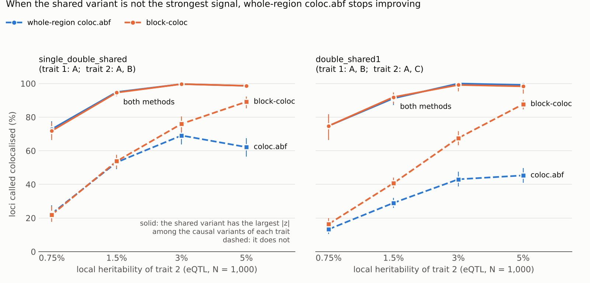
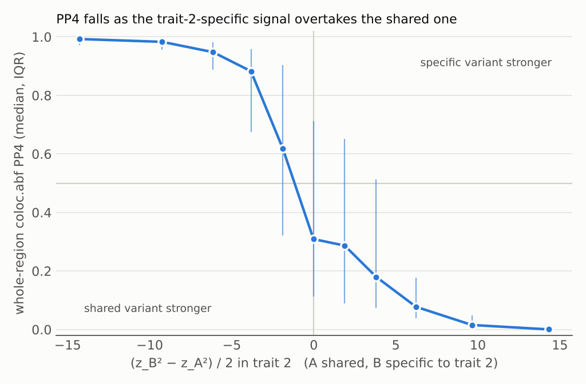

# Theory（草稿）

本页给出关于方法本身的三个结果：整区域 coloc.abf 与分块方法在样本量增大时收敛到什么（§1–§2），块间 LD 带来的、不是条件独立的信号（§3），以及不同因果变异在 LD 中何时可以区分（§4）。每个结果都用已有的逐位点输出核对。2026-11-13 已按 Codex 的独立审查（`collab/partition/REVIEW_P3_codex.md`）和两组补充模拟（§4b、§4c）修订；Proposition F 被降级为粗略近似。记号见 [Model](01_bulk_model.md)，分块模型见 [Partitioned posterior](10_partitioned_posterior.md)。核对脚本：`theory_checks.py`。

## 1. What whole-region coloc.abf converges to

记 $$\mathbf{b}_k = \mathbf{R}\boldsymbol\beta_k$$ 为性状 $$k$$ 的真实边际效应（含 LD 传递），$$j_k^* = \arg\max_j \lvert b_{kj}\rvert$$。

**Proposition C.** 在正态工作模型 $$z_{kj} = \sqrt{N_k}\,b_{kj} + O_p(1)$$ 下，设 SNP 数 $$M$$ 固定，效应 $$\boldsymbol\beta_k$$ 固定且非零，先验为与 $$N$$ 无关的正常数，$$N_1, N_2 \to \infty$$，$$N_1/N_2 \to \kappa \in (0, \infty)$$，$$j_1^*, j_2^*$$ 唯一（排除完全 LD 造成的并列），ABF 的 $$V = O(1/N)$$、$$W$$ 收敛到正常数。则整区域 coloc.abf 的

$$
\mathrm{PP4} \xrightarrow{p} \begin{cases} 1, & j_1^* = j_2^*, \\ 0, & j_1^* \neq j_2^*. \end{cases}
$$

*Proof.* $$z_{kj} = \sqrt{N_k}\,b_{kj} + O_p(1)$$，ABF 的收缩因子 $$W/(W+V_{kj}) \to 1$$，故 $$\log \mathrm{ABF}_{kj} = \tfrac12 N_k b_{kj}^2 + O_p(\sqrt{N_k}) + O(\log N_k)$$。式 (5.2) 中 $$H_4$$ 的分子为 $$p_{12}\sum_j \mathrm{ABF}_{1j}\mathrm{ABF}_{2j}$$，其对数的主项是 $$\tfrac12\max_j (N_1b_{1j}^2 + N_2b_{2j}^2)$$；$$H_3$$ 的分子为 $$p_1p_2\sum_{i\neq j}\mathrm{ABF}_{1i}\mathrm{ABF}_{2j}$$，主项是 $$\tfrac12\max_{i\neq j}(N_1b_{1i}^2 + N_2b_{2j}^2)$$。若 $$j_1^* = j_2^*$$，$$H_4$$ 的主项比 $$H_3$$ 大一个与 $$N$$ 成正比的量；若 $$j_1^* \neq j_2^*$$，则 $$H_3$$ 的主项严格更大。$$H_0, H_1, H_2$$ 缺少至少一个随 $$N$$ 增长的项。先验只贡献常数。$$\square$$

实际的单 SNP OLS 统计量的标准误依赖残差方差，$$z$$ 的极限系数是边际效应除以相应的残差标准差；这通常不改变 $$\lvert b\rvert$$ 的排序，但上面的指数展开是工作模型下的。

**解读.** 在多信号区域，整区域 coloc.abf 检验的不是“是否存在共享的因果变异”（$$H_4^{\mathrm{R}}$$），而是“两性状最强的边际信号是否落在同一个 SNP 上”。当共享变异在某个性状中不是最强信号时，即使真值是共定位，PP4 也随样本量趋于 0。这把 Results §3 的观察（共享信号排在后面时 coloc.abf 漏检）和 §6.1 的观察（$$h^2_2$$ 从 3% 增到 5% 时整区域 coloc.abf 检出率反而下降）统一成一个极限结果。

**启发式解释（不是 Proposition C 的推论）.** 主设计中每个因果变异的 $$\lvert\beta\rvert$$ 相等，因果间 $$\lvert r\rvert < 0.2$$，此时 $$\lvert b_A\rvert^2 - \lvert b_B\rvert^2 = (\beta_A^2 - \beta_B^2)(1 - r^2) = 0$$。这是并列情形，Proposition C 的唯一性条件不成立；而且只比较了 A 与 B，没有排除某个非因果代理 SNP 的边际效应更大（反例：两个互不相关的因果与同一个 SNP 的 $$r$$ 都是 0.7，该 SNP 的边际效应为 $$1.4b$$）。若另外假设所有非因果 SNP 都弱于因果、两个因果的噪声对称，则谁最强由噪声决定，各占一半，整区域 coloc.abf 的检出率约为：single_shared 1，single_double_shared 1/2，double_shared1 1/4（两个性状都要恰好是共享变异最强）。观察到的“共享变异在每个有两个因果的性状中都最强”的比例：single_double_shared 49%，double_shared1 20%–23%，与 1/2、1/4 相符（分层用的是因果变异之间的 $$z$$ 排名，不是全部 SNP 的最大值；这是有限样本的观察，不是极限的验证）。

**核对.** 第二段，按“共享变异是否在每个有两个因果的性状中 $$\lvert z\rvert$$ 最大”分层，测试与校准窗口合并，判定线为第一段的误报率 5% 判定线：

| 场景 | $$h^2_2$$ | 共享变异最强 | n | coloc.abf | block-coloc | coloc.abf 的 PP4 中位数 |
|---|---|---|---|---|---|---|
| single_double_shared | 0.75% | 是 / 否 | 295 / 305 | 72.9 / 22.6 | 71.9 / 22.0 | 0.31 / 0.07 |
| | 1.5% | 是 / 否 | 592 / 608 | 94.9 / 53.1 | 94.6 / 53.8 | 0.70 / 0.16 |
| | 3% | 是 / 否 | 296 / 304 | 99.7 / 69.1 | 99.7 / 76.0 | 0.95 / 0.40 |
| | 5% | 是 / 否 | 296 / 304 | 98.6 / **62.2** | 98.6 / **89.1** | 0.98 / 0.41 |
| double_shared1 | 0.75% | 是 / 否 | 119 / 481 | 74.8 / 13.3 | 74.8 / 16.4 | 0.31 / 0.05 |
| | 1.5% | 是 / 否 | 272 / 928 | 91.2 / 29.0 | 91.9 / 40.7 | 0.68 / 0.06 |
| | 3% | 是 / 否 | 119 / 481 | 100 / 43.0 | 99.2 / 67.6 | 0.92 / 0.09 |
| | 5% | 是 / 否 | 119 / 481 | 99.2 / **45.3** | 98.3 / **87.7** | 0.96 / 0.06 |

（检出率 %。1.5% 一行来自第一段，其余来自第二段。）共享变异最强时，两种方法都趋于 100%；不是最强时，coloc.abf 停滞并开始下降（single_double_shared 69% → 62%），PP4 中位数停在 0.4 以下，block-coloc 则持续上升到 88%–89%。这与 Proposition C 和下面 Proposition D 的预期方向一致；提高 $$h^2$$ 的有限样本比较不是 $$N \to \infty$$ 的验证。

图：第一、二段，低 LD，$$h^2_1 = 0.3\%$$，全部 12 个窗口（判定线由校准窗口的阴性位点确定，阳性位点未参与定线）；竖线为 Wilson 95% 区间。数值见 `results/h2ref_stage2/propC_strata.tsv`，脚本 `scripts/propC.py`。各窗口之间的范围较宽（例如 $$h^2_2 = 5\%$$、single_double_shared、共享变异不是最强时，coloc.abf 在各窗口为 20%–80%），方向在两种场景中一致。

## 1b. Finite-sample behaviour of whole-region PP4

Proposition C 是极限结果。有限样本下，整区域 PP4 随“特有信号比共享信号强多少”连续变化。single_double_shared（性状 1：A；性状 2：A、B），全部性状 2 强度合并（3,000 个位点），按 $$g = (z_{2B}^2 - z_{2A}^2)/2$$ 分组：

| $$g$$（中位数） | n | PP4 中位数 | PP4 均值 |
|---|---|---|---|
| −14.3 | 41 | 0.99 | 0.96 |
| −9.2 | 113 | 0.98 | 0.96 |
| −6.1 | 223 | 0.95 | 0.92 |
| −3.8 | 306 | 0.88 | 0.80 |
| −1.9 | 472 | 0.62 | 0.61 |
| 0.0 | 645 | 0.31 | 0.41 |
| +1.9 | 512 | 0.29 | 0.38 |
| +3.8 | 301 | 0.18 | 0.31 |
| +6.2 | 221 | 0.08 | 0.15 |
| +9.6 | 126 | 0.02 | 0.05 |
| +14.3 | 40 | 0.00 | 0.00 |

- **两端与 Proposition C 一致.** 共享变异明显更强（$$g < -6$$）时 PP4 接近 1；特有变异明显更强（$$g > 10$$）时 PP4 接近 0。PP4 随 $$g$$ 单调下降。
- **过渡区很宽，而且不在两个构型的比较所预测的位置.** 只比较“共享于 A”与“A、B 不同”两个构型时，PP4 应在 $$g \approx \log\{p_{12}/(p_1p_2)\} = 6.9$$ 附近才降到 0.5；实际上 PP4 在 $$g \approx -1.5$$ 就已降到 0.5，两个信号一样强（$$g = 0$$）时中位数只有 0.31。也就是说，共享变异必须明显强于特有变异，整区域 coloc.abf 才给出高 PP4；两者相当时它就已经偏向不共定位。这与 §4b 中构型近似的偏差方向一致（完整后验比两构型的比较更偏向 $$H_3$$），原因（代理 SNP 的求和、ABF 的收缩）没有分别检验。
- **对检出率的含义.** 等大效应下 $$g$$ 关于 0 对称，$$g < 0$$ 的位点占 49%。性状 2 越强，$$\lvert g\rvert$$ 的分布越宽，落在两端的位点越多：$$g < 0$$ 的位点检出率升到接近 100%（73% → 95% → 100% → 99%），$$g > 0$$ 的位点先升后降（22% → 53% → 69% → 62%）。合起来整区域 coloc.abf 的检出率趋于一个低于 1 的平台，这就是 Results §6.1 中 $$h^2_2$$ 从 3% 增到 5% 时不升反降的来源。

**小结（可用于论文的理论动机）.** 多信号区域中，整区域 coloc.abf 的 PP4 由“共享变异相对于各性状其他信号有多强”决定，而不是由“是否存在共享变异”决定；信号越强，这一点越明显。block-coloc 在每个 lead 的 LD 邻域内分别比较，从而不依赖共享变异是否为区域内最强。这一动机不依赖区域后验（[Partitioned posterior](10_partitioned_posterior.md)）或 Proposition F。

## 2. What the partitioned posterior converges to

**Proposition D.** 设划分 $$\mathcal{P}$$ 固定，在每个部分 $$B$$ 内对两性状分别取 $$j_k^*(B) = \arg\max_{j\in B}\lvert b_{kj}\rvert$$（唯一）。在 Proposition C 的渐近条件下，对每个部分，若 $$\mathbf{b}_{k,B} \neq \mathbf{0}$$（$$k = 1, 2$$），则 $$\mathrm{PP4}(B) \to \mathbb{1}\{j_1^*(B) = j_2^*(B)\}$$；若某性状 $$\mathbf{b}_{k,B} = \mathbf{0}$$，则 $$\mathrm{PP4}(B) \to 0$$。于是区域后验 $$\Pr(H_4^{\mathrm{R}}\mid\mathbf{z}) \to 1$$ 当且仅当存在一个部分使两性状的部分内最强信号落在同一 SNP。

*Proof.* 两性状在部分内都有非零信号时应用 Proposition C。某性状在部分内为零时，$$z = O_p(1)$$，其 $$\mathrm{ABF} = O_p(N^{-1/2})$$，$$H_4$$ 相对 $$H_1$$（或 $$H_2$$）趋于 0；两性状都为零时 $$H_0$$ 占优。由 Proposition B，$$1 - \prod_b(1 - \mathrm{PP4}_b) \to 1$$ 当且仅当某个 $$\mathrm{PP4}_b \to 1$$。$$\square$$

**推论（理想划分下的相合性）.** 这是关于固定划分下合成得分的结论。若真实 LD 严格分块（P2）、每个部分每个性状至多一个因果（P3）、因果变异在所分析的 SNP 中、且划分把各因果变异分开：

- 真值 $$H_4^{\mathrm{R}}$$：含共享变异 $$S$$ 的部分内，每个性状只有 $$S$$ 一个因果，$$b_{kj} = r_{jS}\beta_{kS}$$，在 $$S$$ 处取最大，故 $$\Pr(H_4^{\mathrm{R}}) \to 1$$，无论 $$S$$ 在整个区域中是否最强；
- 真值 $$H_3^{\mathrm{R}}$$：每个部分内两性状的因果不同（或某性状无因果、$$\mathbf{b} = \mathbf{0}$$），故 $$\Pr(H_4^{\mathrm{R}}) \to 0$$。

对同一固定划分取最大有相同的 0/1 极限，因为 $$\max_b\mathrm{PP4}_b \to 1$$ 当且仅当某个 $$\mathrm{PP4}_b \to 1$$。

**这不是现行算法的相合性.** 要把结论用于 block-coloc，还需证明 lead 选择和切块以趋于 1 的概率给出满足上述条件的划分，并处理重叠的块、no valid block 和退回规则；这些都没有证明。参考 LD 的误差（489 人）不随性状样本量增大而消失。lead 全部检出也不保证 no valid block 消失：$$\mathbf{R} = \mathbf{I}$$、性状 1 因果 A、B、性状 2 因果 C、D 时，四个 lead 都能检出，但没有任何块同时含两性状的 lead。第二段中 no valid block 的比例随 $$h^2_2$$ 增大而下降（15.0% → 3.8%）只是该设计下的观察。

**条件的分量.** 推论依赖 (P2)：真实 LD 不是严格分块的。若 $$\mathbf{b}_{k,B}$$ 中含有块外因果的贡献，它也随 $$\sqrt{N}$$ 增长，部分内的最强信号可能被块外信号“带偏”。这就是 §3 讨论的、不是条件独立的信号。

## 3. Shadow signals across parts

**Proposition E.** 设部分 $$B$$ 内不含性状 $$k$$ 的因果变异。对 $$j \in B$$，

$$
\mathbb{E}[z_{kj}] = \sum_{c \in \mathcal{C}_k,\, c \notin B} s_{kc}\lambda_{kc}\, r_{jc}, \qquad
\max_{j\in B}\lvert\mathbb{E}[z_{kj}]\rvert \le \sum_{c\notin B}\lambda_{kc}\max_{j\in B}\lvert r_{jc}\rvert .
$$

这里 $$\lambda_{kc} = \sqrt{N_k}\lvert\beta_{kc}\rvert$$ 是结构效应的强度。对 rest 部分（不在任何 lead 的邻域内）的 SNP，与每个 lead 都有 $$\hat r^2 < \rho_b$$；若 lead 就是因果变异且参考 LD 等于真实 LD，则单个因果的 $$\lvert r_{jc}\rvert < \sqrt{\rho_b} = 0.63$$，多个因果的贡献相加。

*Proof.* 由式 (4.3)，$$\mathbb{E}[\mathbf{z}_k] = \sqrt{N_k}\mathbf{R}\boldsymbol\beta_k = \sum_c s_{kc}\lambda_{kc}\mathbf{R}_{\cdot c}$$；块内无因果时只剩块外的项。$$\square$$

**数值.** 默认设定下 $$\lambda_1 = 5.5$$–7.8，这一偏移可达 $$0.63 \times 7.8 = 4.9$$；$$h^2_1 = 2\%$$ 时 $$\lambda_1 = 20$$，可达 12.6。它越过 $$p < 10^{-3}$$（$$\lvert z\rvert > 3.29$$）需要 $$\lambda_{kc}\lvert r_{jc}\rvert > 3.29$$，即 $$\lvert r\rvert = 0.63$$ 时 $$\lambda > 5.2$$。

**含义.**

1. **条件分析只在计数中去掉了这类信号，没有从 coloc 的输入中去掉.** block-coloc 用条件 $$z$$ 决定 lead 个数（在参考 LD 等于真实 LD 时，这类信号的条件 $$z$$ 期望为 0，被计为 lead 的概率降到单次检验的水平），但每个块内的 coloc.abf 用的是边际 $$z$$。若它恰好落在另一性状因果所在的部分且峰值靠近它，该部分可能给出假的 $$H_4$$。`V4_cond_block`（块内先对块外 lead 条件化）正是为此设计的；它只在第一段低 LD 下算过，那里这类信号很弱，没有表现出差别（Results §1 未报告）。
2. **第一、二段的多信号场景没有覆盖这一区域.** double_distinct 中不同性状的因果变异之间要求 $$\lvert r\rvert < 0.2$$（single_distinct 的 mid、high 档是跨性状的一对，但两性状各只有一个信号；double_shared1 的 B–C 在 mid、high 档可以放宽）。§4c 补了多信号、跨性状一对因果 $$\lvert r\rvert \in [0.32, 0.63)$$ 的场景。

## 4. Resolution limit for distinct causal variants in LD

考虑性状 1 的因果 $$A$$、性状 2 的因果 $$B$$，$$\lvert r_{AB}\rvert = r$$，两个信号都已检出。比较“共享于 $$A$$”（$$H_4$$）与“$$A$$、$$B$$ 不同”（$$H_3$$）这两个构型：

$$
\log\frac{\Pr(H_3: A, B)}{\Pr(H_4: A)} = \log\frac{p_1p_2}{p_{12}} + \log\frac{\mathrm{ABF}_{2B}}{\mathrm{ABF}_{2A}}
\approx -\log\frac{p_{12}}{p_1p_2} + \tfrac12\left(z_{2B}^2 - z_{2A}^2\right),
$$

其期望为 $$\tfrac12\lambda_2^2(1 - r^2) - \log\{p_{12}/(p_1p_2)\}$$（$$\mathbb{E}z_{2B}^2 = \lambda_2^2 + 1$$，$$\mathbb{E}z_{2A}^2 = r^2\lambda_2^2 + 1$$）。“共享于 $$B$$”同理，由 $$\lambda_1$$ 决定。

**Proposition F（构型近似；见 §4b 的检验，不是可识别性极限）.** 只比较“A、B 不同”与“共享于 A（或 B）”这两个构型、忽略 ABF 的收缩与其他 SNP 对时，$$H_3$$ 构型的期望对数后验比高于 $$H_4$$ 构型当且仅当

$$
\lambda_{\min}^2\,(1 - r^2) > 2\log\frac{p_{12}}{p_1p_2},
\qquad\text{即}\qquad
r < r^* = \sqrt{1 - \frac{2\log\{p_{12}/(p_1p_2)\}}{\lambda_{\min}^2}},
$$

$$\lambda_{\min} = \min(\lambda_1, \lambda_2)$$。coloc 默认先验下右端为 $$2\log 10^3 = 13.8$$。这不是完整后验的充要条件，也不是 $$\Pr(\mathrm{PP3} > \mathrm{PP4}) = 1/2$$ 的位置：完整的 $$H_3$$、$$H_4$$ 要对所有 SNP 对求和，ABF 还有收缩因子。它也不是一般的可识别性界：样本量或先验改变时交叉点会移动。

| $$h^2_2$$（$$K_2 = 1$$） | $$\lambda_2$$ | $$r^*$$ |
|---|---|---|
| 0.75% | 2.75 | —（$$\lambda_2^2 < 13.8$$） |
| 1.5%（默认） | 3.90 | 0.30 |
| 3% | 5.56 | 0.74 |
| 5% | 7.25 | 0.86 |

**适用范围.** 若某性状信号太弱，后验质量流向 $$H_1$$ 或 $$H_2$$，PP4 本身就小，与 $$r$$ 无关：$$h^2_2 = 0.75\%$$、因果间 $$r \approx 0.03$$ 的 single_distinct 被判为共定位的比例只有 5.3%，并不因 $$\lambda_2^2 < 13.8$$ 而升高。

**核对.** single_distinct，默认 $$\lambda_2 = 3.9$$，全部 12 个窗口，第一段判定线（0.141）：

| LD 档 | $$r$$ 中位数 | $$\lambda_2^2(1 - r^2)$$ | n | coloc.abf 判为共定位 | block-coloc |
|---|---|---|---|---|---|
| low | 0.03 | > 13.8 | 1,200 | 4.1% | 4.4% |
| mid | 0.43 | 10–13.8 | 548 | 22.1% | 22.4% |
| mid | 0.61 | 6–10 | 52 | 42.3% | 42.3% |
| high | 0.70 | 6–10 | 343 | 61.8% | 61.8% |
| high | 0.85 | < 6 | 257 | 89.9% | 89.5% |

误报率随 $$\lambda_2^2(1 - r^2)$$ 下降单调上升，越过 13.8 的位置正好落在 low 档（$$r < 0.2$$）与 mid 档（$$r \ge 0.32$$）之间，与 $$r^* = 0.30$$ 不矛盾，但 LD 分档太粗，不能验证它的位置（Codex 的 Monte Carlo 显示完整后验的交叉点远高于 0.30，见 §4b）。这一失效主要与分块无关：single_distinct 两性状各只有一个因果，多数位点不进入切块分支（默认格 1,200 个中有 201 个因额外的 lead 进入），block-coloc 与整区域 coloc.abf 的误报率相差不到 1 个百分点。

**事先的预测.** $$h^2_2 = 3\%$$ 时 $$r^* = 0.74$$：mid 档（$$r < 0.63$$）的 single_distinct 应基本可区分。检验见 §4b。

## 4b. Test of Proposition F（2026-11-13）

**补充模拟.** $$h^2_2 = 3\%$$（$$\lambda_2 = 5.56$$，$$r^* = 0.74$$）× mid / high LD，每格 12 窗口 × 5 场景 × 50 次（`scripts/block_partition_tier.R`）。事先写下的预测（`collab/partition/STATUS.md`，16:10）：mid 档 single_distinct 被判为共定位的比例降到 10% 以下，high 档只在 $$r > 0.74$$ 处仍高。结果（single_distinct，整区域 coloc.abf，全部 12 个窗口；block-coloc 与之相差不到 1 个百分点）：

| $$r$$ | n | PP4 > 0.141（第一段判定线） | PP4 > PP3 | PP4 > 0.7 | PP3 > 0.7 |
|---|---|---|---|---|---|
| 0.32–0.45 | 313 | 5.8% | 2.6% | 0.6% | 86.6% |
| 0.45–0.55 | 184 | 14.1% | 7.6% | 2.2% | 73.9% |
| 0.55–0.63 | 103 | 22.3% | 12.6% | 7.8% | 72.8% |
| 0.63–0.70 | 168 | 38.1% | 26.8% | 10.7% | 60.7% |
| 0.70–0.74 | 82 | 51.2% | 34.1% | 13.4% | 52.4% |
| 0.74–0.80 | 141 | 62.4% | 46.1% | 30.5% | 44.7% |
| 0.80–0.90 | 209 | 93.3% | 78.9% | 61.7% | 14.4% |

**Codex 的独立 Monte Carlo**（一个校准窗口的参考 LD，977 个 SNP，正态工作模型，$$\lambda_1 = 7.8$$，每个 $$r$$ 取 3 对 SNP × 500 次，共 45,000 次；`RESULTS_CODEX_P3.md`）。完整 coloc.abf 的 $$\Pr(\mathrm{PP3} > \mathrm{PP4})$$ 越过 50% 的位置：

| $$\lambda_2$$ | Proposition F 的 $$r^*$$ | 完整后验的交叉点 |
|---|---|---|
| 3.90 | 0.30 | 0.6–0.7 |
| 5.56 | 0.74 | 0.8–0.9 |
| 7.25 | 0.86 | 0.8–0.9（网格太粗，不能精确定位） |

**结论.**

- **方向正确.** eQTL 变强后分辨力明显提高：mid 档整体 11.2%（默认强度 22%–42%），high 档 64.8%（默认 62%–90%）。
- **定量预测不成立.** “mid 档低于 10%”只在 $$r < 0.45$$ 成立，$$r$$ 为 0.55–0.63 时仍有 22%。
- **$$r^*$$ 不是 PP3 与 PP4 的交叉点.** 弱信号（$$\lambda_2 = 3.9$$）时偏差很大：$$r \approx 0.3$$ 处完整后验仍有 89% 的位点 PP3 > PP4，交叉点在 0.6–0.7。构型近似低估了 $$H_3$$，给出的可分辨范围过于保守。$$\lambda_2 = 5.56$$ 时两组结果一致，交叉点约 0.8，高于 0.74。
- **交叉点也不是误报率.** 按误报率匹配的判定线（0.141）远低于 0.5，误报在远小于交叉点处就开始上升。事先的预测把两者混为一谈。
- **$$\lambda_{\min}^2(1 - r^2)$$ 不是充分的概括量.** 同样约为 17 时，默认强度、$$r = 0.03$$ 的位点误报 4%，这里 $$r = 0.66$$ 的位点误报 38%。

Proposition F 只保留为定性的说明：分辨不同因果变异所需的证据随 $$\lambda^2(1 - r^2)$$ 增加、并需压过先验比 $$p_{12}/(p_1p_2)$$。定量的分辨曲线应直接用模拟给出（上表）。Monte Carlo 只用了一个窗口，不同 $$r$$ 用的是不同的 SNP 对，不能推广到所有区域。

## 4c. Shadow scenarios（2026-11-13）

跨性状的一对因果变异 B（性状 1）–C（性状 2）的 $$\lvert r\rvert$$ 取 0.32–0.63（cross = mid，中位数 0.44）或 < 0.2（cross = low，同一抽样器的对照），其余各对 < 0.2；每格 12 窗口 × 50 次（`scripts/block_partition_shadow.R`）。判定线为第一段的值（0.141 / 0.145）。全部 12 个窗口，%：

| 场景 | $$h^2_1$$ | cross | coloc.abf | block-coloc | 块内条件化（V4） | block-coloc，PP4 > 0.7 | 走切块 |
|---|---|---|---|---|---|---|---|
| double_distinct（性状 1：A, B；性状 2：C, D） | 0.3% | low | 3.7 | 4.0 | 3.8 | 0.5 | 1.3 |
| | 0.3% | mid | 12.8 | 16.3 | 15.8 | 1.8 | 11.5 |
| | 1% | low | 3.5 | 3.5 | 3.5 | 0.2 | 1.3 |
| | 1% | mid | 12.8 | 16.0 | 16.0 | 1.5 | 12.5 |
| double_shared1（性状 1：A, B；性状 2：A, C） | 0.3% | low | 50.5 | 59.7 | 59.5 | 31.5 | 37.8 |
| | 0.3% | mid | 52.7 | 59.5 | 60.3 | 28.5 | 42.3 |
| | 1% | low | 48.3 | 61.3 | 61.3 | 33.8 | 39.0 |
| | 1% | mid | 50.7 | 60.5 | 60.8 | 31.2 | 45.3 |

double_shared1 中走切块的位点里，选中的块包含共享变异 A 的比例：cross = low 时 98%，cross = mid 时 78%–79%（含 C 的 15%）；V4 相同。

对照事先的四条预测（STATUS，16:25）：

1. **阴性位点误报上升：成立.** double_distinct 的误报从 4.0% 升到 16.3%。其中大部分是所有方法共有的：整区域 coloc.abf 也从 3.7% 升到 12.8%，因为 B 与 C 本身就是一对处于中等 LD 的不同因果变异（§4 的现象）。切块额外增加约 3 个百分点（16.3 对 12.8；对照中为 0.3）。
2. **性状 1 更强时更明显：不成立.** $$h^2_1 = 1\%$$ 与 0.3% 的结果相同（16.0% 对 16.3%）。
3. **块内条件化的上升幅度更小：不成立.** V4 与 block-coloc 无差别（15.8% 对 16.3%）。cross = mid、走切块的 double_distinct 位点中（$$h^2_1 = 0.3\%$$，69 个），选中的块同时包含 B 和 C 的占 71%：两者在同一个块里，块外条件化作用不到它们。
4. **共定位位点的定位变差：成立.** 检出率不变（59.5% 对 59.7%），但选中的块含共享变异的比例从 98% 降到 78%。

**含义.** (i) 跨性状的不同因果变异处于中等 LD 时，block-coloc 的误报是整区域 coloc.abf 的约 1.3 倍，固定规则（PP4 > 0.7）下为 1.8% 对 0.8%；这应写入局限。(ii) `V4_cond_block` 不能解决它。(iii) 主要机制不是块外信号在块内的残留（Proposition E），而是同一个块内两个性状的不同因果变异无法区分。

## 5. Summary

| 结果 | 状态（Codex 审查与补充模拟之后） |
|---|---|
| Proposition C：整区域 coloc.abf 收敛到“最强信号是否重合” | 在写明的工作模型下成立；1/2、1/4 的检出率只是启发式解释 |
| Proposition D：固定的理想划分下，合成得分对 $$H_4^{\mathrm{R}}$$ 相合 | 成立；不是现行算法的相合性（lead 选择与切块的一致性未证明） |
| Proposition E：块外因果在块内的均值偏移 | 公式成立；§4c 显示它不是误报上升的主要机制，块内条件化无效 |
| Proposition F：LD 中不同因果的分辨 | 降级为定性说明；$$r^*$$ 既不是 PP3 与 PP4 的交叉点，也不能预测误报率 |
