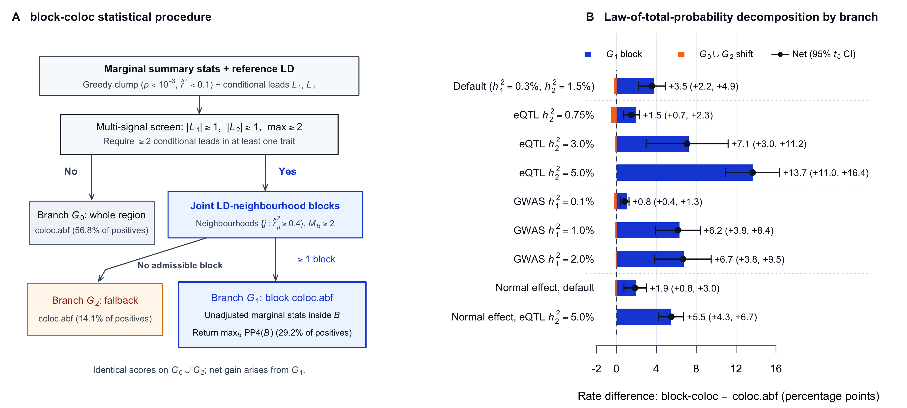
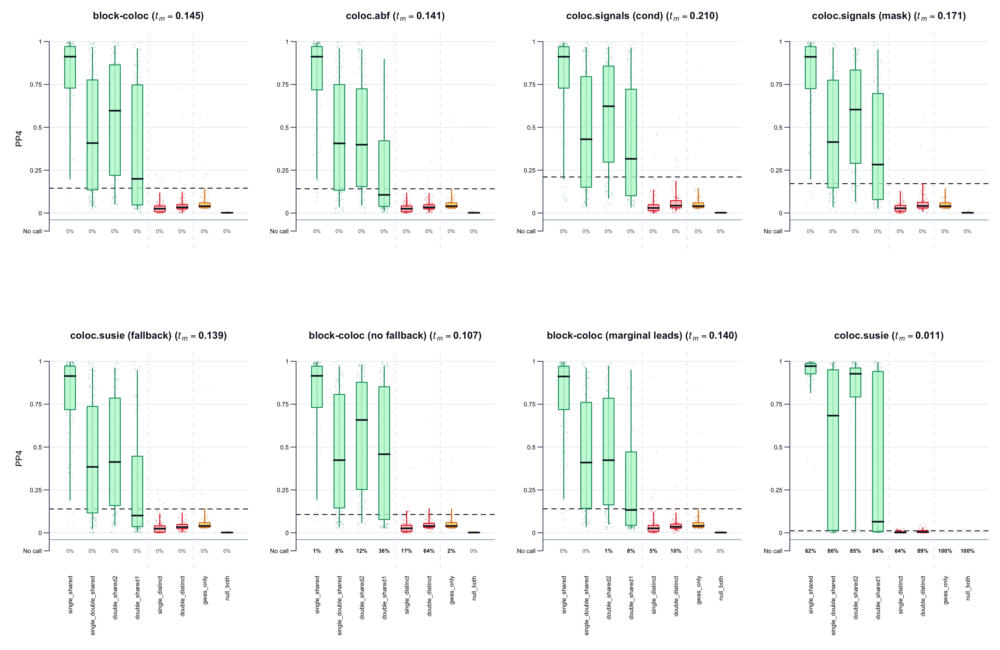

# Figure 1: Workflow and Exact Branch Decomposition



**图 1. `block-coloc` 算法流程与全概率分支分解.** **A** 算法流程：基于外部参考 LD 矩阵 $$\widehat{\mathbf{R}}$$ 实施贪心聚类（$$p < 10^{-3},\ \hat r^2 < 0.1$$）与逐步条件筛选，识别各性状条件独立 lead 集 $$\mathcal{L}_1, \mathcal{L}_2$$；当且仅当两性状均检出信号且至少一性状检出 $$\ge 2$$ 个条件 lead 时进入跨性状 LD 邻域合并分块（$$\hat r^2 \ge 0.4,\ M_B \ge 2$$），在各合格联合块内对未调整原始边际统计量运行 `coloc.abf` 并取极大值（分支 $$\mathcal{G}_1$$），其余情形（未满足多信号条件 $$\mathcal{G}_0$$ 或无合格联合块并归约为全区域统计量 $$\mathcal{G}_2$$）均返回全区域 `coloc.abf` 得分。**B** 九组代表性模拟设定下测试窗口阳性位点检出率差（`block-coloc` 减全区域 `coloc.abf`，单位：百分点）的全概率分解：深蓝横条为有效分块分支 $$\mathcal{G}_1$$ 的边际贡献，橙色横条为 $$\mathcal{G}_0 \cup \mathcal{G}_2$$ 上两条 5% 误报率临界值微移带来的偏移，黑点与误差棒为 6 个测试窗口均值及自由度 5 的 $$t_5$$ 95% 置信区间（因各测试窗口阳性位点数相等，窗口均值与合并位点净差恒等）。



**补充图 1. 第一阶段测试窗口上八种方法在八种因果场景中的 $$\mathrm{PP4}$$ 经验分布与 5% 误报率校准临界值.** 每子图对应一种方法，按标准化场景顺序展示 600 个测试位点的分布；箱体表示四分位距（IQR），中横线为中位数，上下须分别为第 5 与第 95 百分位（浅色散点为抽样分布背景），水平虚线标示各自校准窗口 5% 误报率经验临界值 $$t_m$$；底部行标注未返回有效得分（no call）的位点百分比。

## Analytical framework and empirical decomposition

为验证检出率提升的统计来源与全区域归约分支的作用，按算法执行路径将任一测试位点划分为三个互斥完备事件：未满足多信号筛选条件（$$\mathcal{G}_0$$）、形成至少一个合格联合块（$$\mathcal{G}_1$$）以及虽满足多信号条件但无合格联合块（跨性状邻域不相交、受最小块大小 $$\ge 2$$ 过滤或拟合不收敛）而归约为全区域统计量（$$\mathcal{G}_2$$）。在事件 $$\mathcal{G}_0 \cup \mathcal{G}_2$$ 上，`block-coloc` 统计量 $$T_{\mathrm{bc}}$$ 与全区域 `coloc.abf` 统计量 $$X$$ 逐样本完全相等（实测最大绝对差为 $$0$$）。由全概率公式，共定位阳性假设 $$H_4^{\mathrm{R}}$$ 下的检出率差严格满足如下分解：

$$
\Pr(T_{\mathrm{bc}} > t_{\mathrm{bc}} \mid H_4^{\mathrm{R}}) - \Pr(X > t_{\mathrm{abf}} \mid H_4^{\mathrm{R}})
= \sum_{\mathcal{G} \in \{\mathcal{G}_0, \mathcal{G}_1, \mathcal{G}_2\}} \Pr(\mathcal{G} \mid H_4^{\mathrm{R}})\,\Big\{\Pr(T_{\mathrm{bc}} > t_{\mathrm{bc}} \mid \mathcal{G}, H_4^{\mathrm{R}}) - \Pr(X > t_{\mathrm{abf}} \mid \mathcal{G}, H_4^{\mathrm{R}})\Big\} \,. \tag{F1.1}
$$

表 1 在 9 组模拟设定（6 个独立测试窗口）上给出式 (F1.1) 各分支概率、边际贡献（百分点）、6 窗口 $$t_5$$ 95% 区间以及无归约全区域分支对照下的敏感性：

| 模拟设定（测试窗口阳性） | $$n_{\mathrm{pos}}$$ | $$\mathcal{G}_0 / \mathcal{G}_1 / \mathcal{G}_2$$ 占比（%） | 净差与 $$t_5$$ 95% CI（百分点） | $$\mathcal{G}_1$$ 贡献 | $$\mathcal{G}_0 \cup \mathcal{G}_2$$ 偏移 | $$\mathcal{G}_1$$ 新检出命中共享因果 | 无 $$\mathcal{G}_2$$ 归约损失阳性（%） |
|---|---:|---|---:|---:|---:|---|---:|
| 默认（$$h^2_1 = 0.3\%, h^2_2 = 1.5\%$$） | 2,400 | 56.8 / 29.2 / 14.1 | +3.5 (+2.2, +4.9) | +3.8 | −0.2 | 100.0%（98 / 98） | 6.2 |
| $$h^2_1 = 0.1\%, h^2_2 = 1.5\%$$ | 1,200 | 74.4 / 14.6 / 11.0 | +0.8 (+0.4, +1.3) | +1.1 | −0.2 | 92.3%（12 / 13） | 3.8 |
| $$h^2_1 = 0.3\%, h^2_2 = 0.75\%$$ | 1,200 | 73.6 / 12.9 / 13.5 | +1.5 (+0.7, +2.3) | +2.0 | −0.5 | 92.6%（25 / 27） | 4.4 |
| $$h^2_1 = 0.3\%, h^2_2 = 3.0\%$$ | 1,200 | 32.9 / 56.3 / 10.8 | +7.1 (+3.0, +11.2) | +7.2 | −0.2 | 100.0%（89 / 89） | 5.2 |
| $$h^2_1 = 0.3\%, h^2_2 = 5.0\%$$ | 1,200 | 23.2 / 73.0 / 3.8 | +13.7 (+11.0, +16.4) | +13.7 | 0.0 | 100.0%（165 / 165） | 1.6 |
| $$h^2_1 = 1.0\%, h^2_2 = 1.5\%$$ | 1,200 | 52.8 / 31.6 / 15.6 | +6.2 (+3.9, +8.4) | +6.3 | −0.2 | 100.0%（76 / 76） | 7.0 |
| $$h^2_1 = 2.0\%, h^2_2 = 1.5\%$$ | 1,200 | 49.7 / 34.4 / 15.9 | +6.7 (+3.8, +9.5) | +6.8 | −0.1 | 97.6%（81 / 83） | 7.0 |
| 正态效应：默认（各自校准） | 2,400 | 81.2 / 11.4 / 7.3 | +1.9 (+0.8, +3.0) | +2.0 | −0.1 | 100.0%（48 / 48） | 2.0 |
| 正态效应：$$h^2_2 = 5.0\%$$（各自校准） | 1,200 | 67.0 / 22.3 / 10.7 | +5.5 (+4.3, +6.7) | +5.5 | 0.0 | 100.0%（67 / 67） | 2.2 |

*Note.* 表中净差、$$\mathcal{G}_1$$ 贡献与 $$\mathcal{G}_0 \cup \mathcal{G}_2$$ 偏移均由未舍入计数值独立保留 1 位小数（例如默认行精确值为 $$3.79 - 0.25 = 3.54$$ 个百分点），故行内显示值之和可能差 $$0.1$$；各窗口阳性位点数相同，故合并净差等于 6 测试窗口等权均值。

## Statistical interpretation

1. **总净增益由有效分块分支 $$\mathcal{G}_1$$ 主导**：在默认设定下，29.2% 进入 $$\mathcal{G}_1$$ 的阳性位点使组内检出率由全区域 `coloc.abf` 的 84.7% 升至 97.7%，贡献 +3.8 个百分点（总净差 +3.5）；在全部 9 组设定中，92.3%–100.0% 的新检出位点所选最佳块均覆盖真实共享因果变异（默认最佳块中位 SNP 数为 46），而 $$\mathcal{G}_0 \cup \mathcal{G}_2$$ 上由经验临界值微移导致的偏移始终 $$\le 0$$（绝对值 $$\le 0.5$$ 个百分点）。
2. **全区域归约分支 $$\mathcal{G}_2$$ 避免无合格块时的信息损失**：当一性状检出双信号而另一性状仅在非共享位点检出单 lead 时，邻域互不相交（默认设定占 14.1%）。若将该分支直接判为无结果而非归约为全区域（即 `block-coloc (no fallback)`），将在各设定上损失 1.6%–7.0% 的原本可检出阳性位点，使默认设定合并检出率回落至 73.8%。
3. **校准阴性极少进入分块分支使经验临界值高度接近**：第一阶段 1,200 个校准阴性位点中仅 1.3%（9 组设定为 0.5%–1.8%）进入 $$\mathcal{G}_1$$。由经验分位数扰动界引理（[Supplementary](supplement.md) Lemma S3），`block-coloc` 经验临界值 $$t_{\mathrm{bc}} = 0.145$$ 紧贴全区域 $$t_{\mathrm{abf}} = 0.141$$，确保局部块统计量不会因临界值剧烈漂移而抵消 $$\mathcal{G}_1$$ 增益。

## Reproducibility

```bash
python3 scripts/gain_decomposition.py
Rscript scripts/evaluate.R --stage main
Rscript scripts/plot_main_figures.R
```
