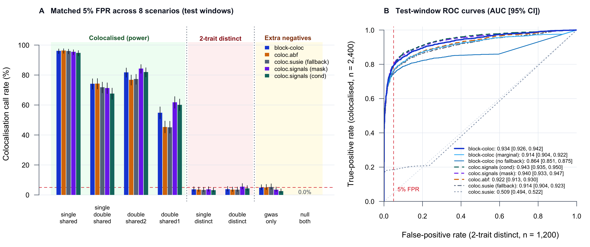
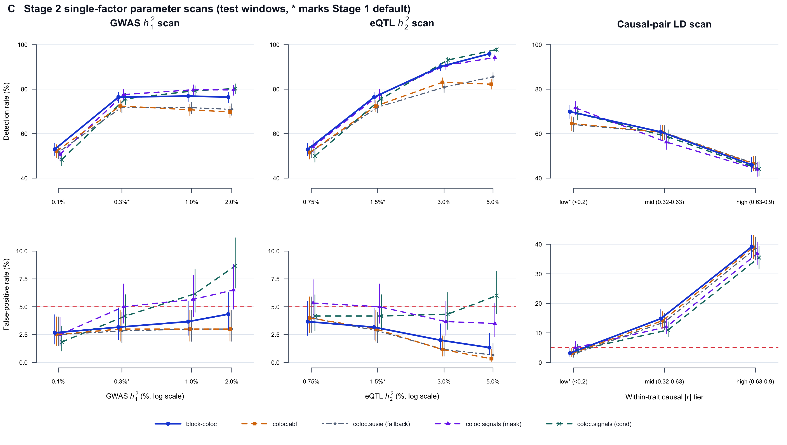

# Figure 2: Detection Power, Type I Error, and Signal-Strength Grids



**图 2A–B. 第一阶段默认参考 LD 设定下八种场景的匹配误报率表现与测试窗口 ROC 曲线.** **A** 在校准窗口按 5% 误报率固定临界值后，五种主要方法在八种因果配置中的共定位判定比例（每场景 600 个测试位点：6 测试窗口 $$\times$$ 100 次重复，误差棒为位点层面 Wilson 95% 置信区间）。背景色带分隔共定位阳性（前四场景，检出率）、双性状独立信号阴性（中间两场景，误报率）与不参与校准临界值的单性状/全零额外阴性；水平虚线为 5% 名义误报率（`null_both` 各方法均精确为 0.0%）。**B** 测试窗口合并阳性（$$n = 2{,}400$$）与双性状独立阴性（$$n = 1{,}200$$）上的 ROC 曲线及曲线下面积（AUC 与 95% 自举区间）；实线为 `block-coloc` 系列，虚线为对照方法，未返回结果位点排在最末（$$-\infty$$）。



**图 2C. 第二阶段单因素扫描中检出率（上排，纵轴截断于 38%–102%）与误报率（下排）随关键参数的变化（测试窗口，沿用第一阶段固定临界值）.** 自默认设定（$$h^2_1 = 0.3\%, h^2_2 = 1.5\%$$，因果 LD 档位 `low`，以 `*` 标注）出发每次仅改变一个维度：左列与中列分别在常用对数横轴上扫描 GWAS $$h^2_1$$ 与 eQTL $$h^2_2$$（下排误报率纵轴范围为 0%–12.2%）；右列扫描同性状因果 LD 档位（因高 LD 下假阳性率大幅攀升，下排纵轴范围为 0%–46.0%）。误差棒为 Wilson 95% 置信区间；下排水平虚线为 5% 误报率。

## Empirical results

### Stage 1: Default reference-LD benchmark and clustered inference

表 2A 总结测试窗口在 5% 校准临界值下的场景分项检出率、误报率及完整 ROC 指标（%）：

| 场景或评价指标 | `block-coloc` | `block-coloc (no fallback)` | `block-coloc (marginal leads)` | `coloc.abf` | `coloc.susie (fallback)` | `coloc.signals (mask)` | `coloc.signals (cond)` |
|---|---:|---:|---:|---:|---:|---:|---:|
| `single_shared` $$(1,0,0)$$ | 96.2 | 96.2 | 96.3 | 96.3 | 96.0 | 95.5 | 94.8 |
| `single_double_shared` $$(1,0,1)$$ | 74.2 | 74.3 | 74.7 | 74.3 | 71.8 | 71.3 | 67.7 |
| `double_shared2` $$(2,0,0)$$ | 81.8 | 78.5 | 77.7 | 76.8 | 77.3 | 84.3 | 82.0 |
| `double_shared1` $$(1,1,1)$$ | 54.8 | 46.0 | 44.5 | 45.3 | 45.2 | 61.8 | 60.2 |
| **合并检出率（$$n = 2{,}400$$）** | **76.8** | 73.8 | 73.3 | 73.2 | 72.6 | **78.2** | 76.2 |
| `single_distinct` 误报率 | 3.7 | 5.3 | 3.7 | 3.5 | 3.3 | 3.7 | 3.2 |
| `double_distinct` 误报率 | 3.8 | 3.3 | 3.3 | 3.5 | 3.5 | 5.5 | 4.3 |
| `gwas_only` / `null_both` 假阳性率 | 4.8 / 0.0 | 7.7 / 0.0 | 5.2 / 0.0 | 5.0 / 0.0 | 5.3 / 0.0 | 3.5 / 0.0 | 2.5 / 0.0 |
| AUC [95% CI] | 0.934 [0.926, 0.942] | 0.864 [0.851, 0.875] | 0.914 [0.904, 0.922] | 0.922 [0.913, 0.930] | 0.914 [0.904, 0.923] | 0.940 [0.933, 0.947] | 0.943 [0.935, 0.950] |
| 校准临界值 $$t_m$$ | 0.145 | 0.107 | 0.140 | 0.141 | 0.139 | 0.171 | 0.210 |

*Note.* 单独运行 `coloc.susie` 时，由于 $$N_2 = 1{,}000$$ 队列在 62%–89% 的测试位点（合计 78.3%）未检出任何 credible set，合并检出率仅为 18.3% [16.8%, 19.9%]，AUC 为 0.509 [0.494, 0.522]，阈值为 0.011。

针对同一窗口内位点共享 LD 结构的聚类相关性，表 2B 以 6 个独立测试窗口的 $$t_5$$ 区间与校准—测试窗口 Bootstrap 区间作为主要配对统计推断（合并位点 Wald 区间与精确 McNemar 检验 $$p$$ 值未校正窗口内相关性，仅作描述性补充）：

| 配对比较（测试窗口阳性） | 配对检出率差（百分点） | 6 测试窗口 $$t_5$$ 95% CI | 校准—测试窗口 Bootstrap 95% CI | 差值 $$> 0$$ 窗口数 | 位点层面 Wald 95% CI（描述性 McNemar $$p$$） |
|---|---:|---|---|---:|---|
| `block-coloc` 减 `coloc.abf` | +3.5 | (+2.2, +4.9) | (+1.6, +4.5) | 6 / 6 | (+2.7, +4.4)，$$p < 10^{-15}$$ |
| `block-coloc` 减 `coloc.susie (fallback)` | +4.2 | (+2.5, +5.8) | (+1.4, +5.1) | 6 / 6 | (+3.2, +5.1)，$$p < 10^{-15}$$ |
| `block-coloc` 减 `coloc.signals (cond)` | +0.6 | (−1.6, +2.8) | (−2.6, +2.3) | 2 / 6 | (−0.6, +1.8)，$$p = 0.38$$ |
| `block-coloc` 减 `coloc.signals (mask)` | −1.5 | (−4.5, +1.5) | (−4.1, +1.0) | 2 / 6 | (−2.6, −0.4)，$$p = 0.007$$ |

### Stage 2: One-factor-at-a-time signal strength and causal-LD scans

表 2C 汇报沿用第一阶段固定临界值时，各单因素扫描设定的合并检出率与括号内双性状独立阴性误报率（%）：

| 扫描参数取值 | 双信号 $$\lambda_k$$ | `block-coloc` | `coloc.abf` | `coloc.susie (fallback)` | `coloc.signals (mask)` | `coloc.signals (cond)` | `block-coloc` 减 `coloc.abf`（窗口 $$t_5$$ 95% CI） |
|---|---:|---:|---:|---:|---:|---:|---|
| $$h^2_2 = 0.75\%$$ | 1.94 | 52.9 (3.7) | 51.4 (4.0) | 51.9 (4.0) | 54.1 (5.3) | 50.0 (4.2) | +1.5 (+0.7, +2.3) |
| $$h^2_2 = 1.5\%$$ | 2.75 | 76.4 (3.2) | 72.4 (3.0) | 71.9 (2.8) | 77.6 (5.0) | 75.7 (4.2) | +4.0$$^a$$ |
| $$h^2_2 = 3.0\%$$ | 3.90 | 90.2 (2.0) | 83.1 (1.2) | 80.8 (1.2) | 90.7 (3.7) | 93.1 (4.3) | +7.1 (+3.0, +11.2) |
| $$h^2_2 = 5.0\%$$ | 5.06 | 95.9 (1.3) | 82.2 (0.3) | 85.6 (0.7) | 94.2 (3.5) | 97.8 (6.0) | +13.7 (+11.0, +16.4) |
| $$h^2_1 = 0.1\%$$ | 3.16 | 53.0 (2.7) | 52.2 (2.5) | 51.6 (2.5) | 50.7 (2.5) | 48.3 (1.8) | +0.8 (+0.4, +1.3) |
| $$h^2_1 = 1.0\%$$ | 10.03 | 76.9 (3.7) | 70.8 (3.0) | 71.7 (3.0) | 79.8 (5.7) | 79.3 (6.2) | +6.2 (+3.9, +8.4) |
| $$h^2_1 = 2.0\%$$ | 14.21 | 76.4 (4.3) | 69.8 (3.0) | 70.9 (3.0) | 79.7 (6.5) | 80.2 (8.7) | +6.7 (+3.8, +9.5) |
| LD 档位：`low`（$$< 0.2$$） | — | 69.9 (3.2) | 64.6 (3.0) | 64.0 (2.8) | 71.6 (5.0) | 69.2 (4.2) | +5.3$$^b$$ |
| LD 档位：`mid`（0.32–0.63） | — | 60.8 (14.8) | 60.6 (14.2) | 59.8 (14.0) | 56.2 (12.0) | 58.6 (11.0) | +0.2 (−0.9, +1.4) |
| LD 档位：`high`（0.63–0.90） | — | 46.0 (39.2) | 46.6 (39.0) | 46.4 (38.8) | 44.0 (36.8) | 44.1 (35.5) | −0.6 (−1.6, +0.5) |

*Note.* $$^a$$ 第二阶段 50 次重复默认参数设定（$$n_{\mathrm{pos}} = 1{,}200$$）；对应第一阶段 100 次重复（$$n_{\mathrm{pos}} = 2{,}400$$）的配对差为 +3.5（窗口 $$t_5$$ 95% CI: +2.2, +4.9；详见 [Supplementary](supplement.md) 表 S2）。$$^b$$ LD 档位扫描仅涵盖含多信号的三个阳性场景（$$n_{\mathrm{pos}} = 900$$）。在校准—测试窗口 Bootstrap 区间下，除信号最弱的两组（$$h^2_2 = 0.75\%$$ 与 $$h^2_1 = 0.1\%$$）外，所有低 LD 设定均严格大于零。

## Statistical interpretation

1. **默认设定与窗口层面稳健性**：在外部参考 LD 下，`block-coloc` 检出率为 76.8%，高于全区域 `coloc.abf`（73.2%；窗口 $$t_5$$ CI: +2.2, +4.9）与 `coloc.susie (fallback)`（72.6%；CI: +2.5, +5.8），并与 `coloc.signals (cond)`（76.2%；CI: −1.6, +2.8）接近；相对 `coloc.signals (mask)` 的 −1.5 个百分点差异在窗口层面包含零（$$t_5$$ CI: −4.5, +1.5）。
2. **多信号强度递增下的功效分化与误报率漂移**：默认设定下 `block-coloc` 的增益受限于 $$h^2_2 = 1.5\%$$ 时 eQTL 双 lead 检出率较低（$$\lambda_2 = 2.75$$，双 lead 比例 15.9%）。当 $$h^2_2$$ 升至 3.0% 与 5.0% 时，eQTL 双 lead 检出率升至 55.9% 与 89.3%，全区域 `coloc.abf` 因特有信号竞争停滞在 82.2%–83.1%，而 `block-coloc` 升至 90.2% 与 95.9%（增益 +7.1 与 +13.7 个百分点）。当 $$h^2_1$$ 升至 2.0% 时，`coloc.signals (cond)` 受参考 LD 条件残余均值偏移影响（[Method](method.md) 式 4.1–4.2），误报率升至 8.7%，而 `block-coloc` 误报率保持在 4.3%。
3. **中强连锁因果对下的有限样本可分性界限**：当不同性状或同性状独立因果间相关性处于 $$\lvert r\rvert \ge 0.32$$ 时，`single_distinct` 误报率在所有方法下同步升至约 25%（`mid`）与 75%（`high`）。该现象反映在当前样本量、效应强度与固定 5% 临界值下基于边际汇总贝叶斯因子的有限样本分辨能力下降（而非渐近意义下的不可识别；当 $$\lvert r\rvert < 1$$ 且增大样本量时仍满足 [Supplementary](supplement.md) Proposition S1 的渐近分离条件）。

## Reproducibility

```bash
Rscript scripts/run.R --stage main --cores 4 && Rscript scripts/evaluate.R --stage main
Rscript scripts/run.R --stage grid --cores 3 && Rscript scripts/evaluate.R --stage grid
python3 scripts/grid_paired.py
python3 scripts/window_inference.py outputs/bulk_h2ref_v1/window_inference.md
Rscript scripts/plot_main_figures.R
```
