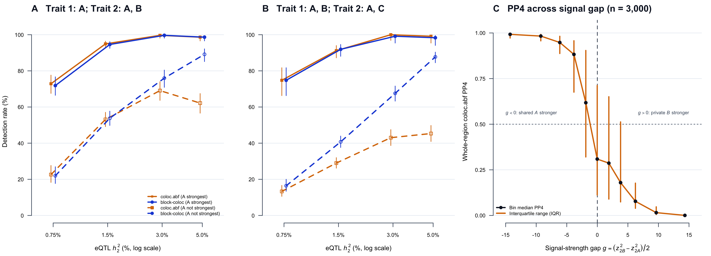

# Figure 3: Multi-Signal Behaviour of Whole-Region coloc.abf



**图 3. 全区域 `coloc.abf` 在多信号下的“最强信号重合”理论验证（合并全部 12 窗口以扩充层级样本量）.** **A–B** 按共享变异 $$A$$ 是否在全部含双因果性状的因果变异中取得最大边际 $$\lvert z\rvert$$ 分层后的检出率（**A** 性状 1 为 $$A$$、性状 2 为 $$A, B$$；**B** 性状 1 为 $$A, B$$、性状 2 为 $$A, C$$）。实线表示 $$A$$ 为最强边际信号，虚线表示非最强信号，误差棒为位点层面 Wilson 95% 置信区间（低 LD 档位，$$h^2_1 = 0.3\%$$，超越第一阶段 5% 经验临界值 0.141 与 0.145 的比例）。**C** `single_double_shared` 场景下全区域 `coloc.abf` 的 $$\mathrm{PP4}$$ 随性状 2 私有与共享信号强度差 $$g = (z_{2B}^2 - z_{2A}^2)/2$$ 的过渡曲线（3,000 个合并位点等分为 11 组，圆点为组内中位数，竖线为四分位距 IQR；竖线 $$g = 0$$ 与横线 $$\mathrm{PP4} = 0.5$$ 标示强弱反转点与后验中点）。

## Analytical characterization and stratified empirical test

本页实验直接检验全区域 `coloc.abf` 在多因果设定下的渐近极限定理（[Supplementary](supplement.md) Proposition S1）与有限样本五假设恒等分解（Lemma S1）。记性状 $$k$$ 的真实边际效应向量为 $$\mathbf{b}_k = \mathbf{R}_k \boldsymbol\beta_k$$，极大绝对效应位置为 $$j_k^* = \arg\max_j \lvert b_{kj}\rvert$$。在正态近似模型及唯一最大值条件下，当 $$N_1, N_2 \to \infty$$ 且 $$N_1 / N_2 \to \kappa \in (0, \infty)$$ 时，全区域 `coloc.abf` 渐近收敛至“最强边际信号是否重合”的指示函数：

$$
\mathrm{PP4} \xrightarrow{p} \begin{cases} 1, & j_1^* = j_2^*, \\ 0, & j_1^* \neq j_2^* \,. \end{cases} \tag{F3.1}
$$

对于有限样本，记 $$S_k = \sum_{j=1}^M \mathrm{ABF}_{kj}$$、$$S_{12} = \sum_{j=1}^M \mathrm{ABF}_{1j}\mathrm{ABF}_{2j}$$、条件加权均值 $$m_2 = S_{12}/S_1$$ 及 $$\pi_{0,1} := \mathrm{PP0} + \mathrm{PP2}$$，Lemma S1 给出

$$
\mathrm{PP4} = (1 - \pi_{0,1})\,\frac{(p_{12}/p_1)\,m_2}{1 + (p_{12}/p_1)\,m_2 + p_2(S_2 - m_2)} \,. \tag{F3.2}
$$

表 3 汇总了按共享变异是否最强分层的实测检出率（%）与中位 $$\mathrm{PP4}$$（合并全部 12 窗口作为机理诊断补充）：

| 因果场景 | $$h^2_2$$ | 共享变异最强（是 / 否）位点数 | `coloc.abf` 检出率：是 / 否（%） | `block-coloc` 检出率：是 / 否（%） | `coloc.abf` 中位 $$\mathrm{PP4}$$：是 / 否 |
|---|---|---|---:|---:|---|
| `single_double_shared` | 0.75% | 295 / 305 | 72.9 / 22.6 | 71.9 / 22.0 | 0.31 / 0.07 |
| | 1.5% | 592 / 608 | 94.9 / 53.1 | 94.6 / 53.8 | 0.70 / 0.16 |
| | 3.0% | 296 / 304 | 99.7 / 69.1 | 99.7 / 76.0 | 0.95 / 0.40 |
| | 5.0% | 296 / 304 | 98.6 / 62.2 | 98.6 / 89.1 | 0.98 / 0.41 |
| `double_shared1` | 0.75% | 119 / 481 | 74.8 / 13.3 | 74.8 / 16.4 | 0.31 / 0.05 |
| | 1.5% | 272 / 928 | 91.2 / 29.0 | 91.9 / 40.7 | 0.68 / 0.06 |
| | 3.0% | 119 / 481 | 100.0 / 43.0 | 99.2 / 67.6 | 0.92 / 0.09 |
| | 5.0% | 119 / 481 | 99.2 / 45.3 | 98.3 / 87.7 | 0.96 / 0.06 |

*Note.* 按 [Method](method.md) 式 (1.3)–(1.4) 的等幅重标定设计，共享因果与非共享因果在对称噪声下等概率取得最大 $$\lvert z\rvert$$，对应实测共享最强层占比接近理论启发比例 $$1/2$$（`single_double_shared`）与 $$1/4$$（`double_shared1`）。

## Statistical interpretation

1. **多信号下全区域 `coloc.abf` 检验“最强信号重合”而非“存在共享信号”**：当共享变异 $$A$$ 在各性状中均居首位时，全区域 `coloc.abf` 与 `block-coloc` 随 $$h^2_2$$ 同步趋近 100%；而当私有变异强于 $$A$$ 时，全区域 `coloc.abf` 质量向 $$H_3$$ 集中，检出率在 $$h^2_2 = 5.0\%$$ 时停滞在 45.3%–62.2%，而 `block-coloc` 借助邻域局部化隔离特有信号，将检出率提升至 87.7%–89.1%。
2. **有限样本中点 $$g = 0$$ 处与 $$H_1$$ 假设的竞争机制**：若仅比较单构型 $$H_4(A)$$ 与 $$H_3(A, B)$$，$$\mathrm{PP4} = 0.5$$ 应出现在 $$g \approx a_{2A}^{-1}\log\{p_{12}/(p_1 p_2)\} \approx 7.6$$ 处，但实测在 $$g = 0$$ 处全区域中位 $$\mathrm{PP4}$$ 仅为 0.31。由式 (F3.2)，默认先验 $$p_{12}/p_1 = 0.1$$ 使分母中对应 $$H_1$$ 的常数项 $$1$$ 直接与 $$0.1\,m_2$$ 竞争：合并样本在 $$g \approx 0$$ 处包含中低信噪比位点（中位 $$\lvert z_{2A}\rvert = 2.53$$；按 $$h^2_2$$ 四档拆分时 $$g \approx 0$$ 附近组内中位 $$\mathrm{PP4}$$ 依次为 0.09、0.31、0.84、0.96），叠加私有变异 $$B$$ 代理群对 $$S_2$$ 的累积放大，共同塑造了图 3C 的非线性过渡曲线。

## Reproducibility

```bash
python3 scripts/propC.py
python3 scripts/theory_checks.py
Rscript scripts/plot_main_figures.R
```
