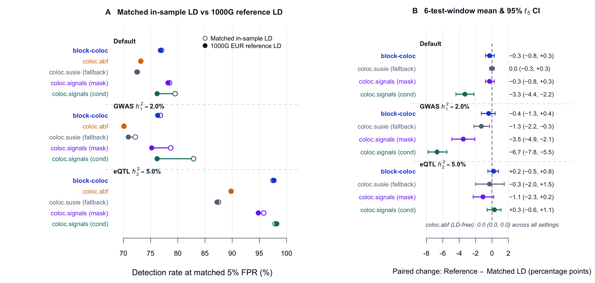

# Figure 4: Matched In-Sample LD vs 1000 Genomes Reference LD



**图 4. 样本内匹配 LD 与 1000 Genomes EUR 参考 LD 下各方法的逐位点配对比较（测试窗口）.** **A** 同一批阳性测试位点在使用各队列精确样本内 LD（空心点，$$\mathbf{R}_1, \mathbf{R}_2$$）与外部 1000 Genomes EUR 参考 LD（实心点，$$\widehat{\mathbf{R}}$$，$$n_{\mathrm{ref}} = 489$$）下的匹配 5% 误报率检出率变化，全面涵盖默认设定（$$n = 2{,}400$$）、强 GWAS 设定（$$h^2_1 = 2.0\%,\ n = 1{,}200$$）与强 eQTL 设定（$$h^2_2 = 5.0\%,\ n = 1{,}200$$）。**B** 对应上述三组设定的四项 LD 依赖方法在换成参考 LD 后的配对检出率变化（参考 LD 减匹配 LD，百分点），圆点与误差棒分别为 6 个测试窗口均值及自由度 5 的 $$t_5$$ 95% 置信区间（`coloc.abf` 不使用 LD 矩阵，变化恒为 0.0）。

## Paired validation under matched and reference LD

为检验 [Method](method.md) 式 (4.1)–(4.2) 预言的条件残余膨胀与 [Supplementary](supplement.md) Proposition S5 刻画的原始边际块稳定性，本实验保持基因型窗口、因果变异、表型实现及边际汇总统计量完全一致，仅将分析 LD 矩阵由样本内精确矩阵（$$N_1 = 20{,}000$$ 与 $$N_2 = 1{,}000$$）替换为 1000 Genomes EUR 参考面板，并在各自 LD 来源的校准窗口重新校准 5% 误报率临界值。表 4 完整汇报全部三组设定的检出率、误报率与窗口配对差异：

| 模拟设定 | 方法 | 检出率：匹配 / 参考（%） | 误报率：匹配 / 参考（%） | 6 窗口配对差：参考减匹配（$$t_5$$ 95% CI） |
|---|---|---:|---:|---|
| 默认（$$h^2_1 = 0.3\%, h^2_2 = 1.5\%$$） | `block-coloc` | 77.0 / 76.8 | 3.8 / 3.8 | −0.3 (−0.8, +0.3) |
| | `coloc.abf` | 73.2 / 73.2 | 3.5 / 3.5 | 0.0 (0.0, 0.0) |
| | `coloc.susie (fallback)` | 72.5 / 72.6 | 3.5 / 3.4 | 0.0 (−0.3, +0.3) |
| | `coloc.signals (mask)` | 78.5 / 78.2 | 4.8 / 4.6 | −0.3 (−0.8, +0.3) |
| | `coloc.signals (cond)` | 79.5 / 76.2 | 4.4 / 3.8 | **−3.3 (−4.4, −2.2)** |
| 强 GWAS（$$h^2_1 = 2.0\%, h^2_2 = 1.5\%$$） | `block-coloc` | 76.8 / 76.3 | 3.7 / 4.3 | −0.4 (−1.3, +0.4) |
| | `coloc.abf` | 70.1 / 70.1 | 3.0 / 3.0 | 0.0 (0.0, 0.0) |
| | `coloc.susie (fallback)` | 72.2 / 70.9 | 4.0 / 3.0 | **−1.3 (−2.2, −0.3)** |
| | `coloc.signals (mask)` | 78.7 / 75.2 | 4.5 / 4.5 | **−3.5 (−4.9, −2.1)** |
| | `coloc.signals (cond)` | 82.9 / 76.2 | 5.2 / 6.5 | **−6.7 (−7.8, −5.5)** |
| 强 eQTL（$$h^2_1 = 0.3\%, h^2_2 = 5.0\%$$） | `block-coloc` | 97.5 / 97.7 | 6.2 / 6.8 | +0.2 (−0.5, +0.8) |
| | `coloc.abf` | 89.8 / 89.8 | 5.0 / 5.0 | 0.0 (0.0, 0.0) |
| | `coloc.susie (fallback)` | 87.5 / 87.2 | 4.8 / 5.2 | −0.3 (−2.0, +1.5) |
| | `coloc.signals (mask)` | 95.8 / 94.8 | 7.7 / 6.2 | −1.1 (−2.3, +0.2) |
| | `coloc.signals (cond)` | 97.9 / 98.2 | 5.5 / 7.5 | +0.3 (−0.6, +1.1) |

*Note.* 表中全部差值与置信区间均由各测试窗口均值独立计算；合并位点配对差与 6 窗口等权均值在个别条目末位相差 0.1 个百分点（如默认设定 `block-coloc` 与 `coloc.signals (mask)` 位点差为 −0.2，强 GWAS 设定 `coloc.susie (fallback)` 位点差为 −1.2）。`coloc.signals (cond)` 在默认与强 GWAS 两组设定的全部 6 个独立测试窗口中均出现下降。

## Statistical interpretation and scope of application

1. **参考 LD 失配下不同方法敏感度分化的统计机理**：在 $$h^2_1 = 2.0\%$$（$$\lambda_1 \in [14.21, 20.20]$$）下，信号强度逼近 1000 Genomes EUR 第 99 百分位误差 0.15 下产生假条件信号（条件均值达到显著性临界值）的信号强度尺度 $$\lambda^* \approx 22$$（[Method](method.md) 式 4.2）。尽管参考误差使 `block-coloc` 单信号位点进入分块的比例上升（如 `single_shared` 由 13.0% 升至 24.2%），按分支事件的逐位点配对分解显示：(i) 默认与 $$h^2_1 = 2.0\%$$ 两组设定分别有 95.0% 与 90.3% 的阳性位点保持分支路径不变；(ii) 两次均进入 $$\mathcal{G}_1$$ 时块内仅读取未经参考 LD 条件调整的原始边际统计量（固定公共单点 ABF 与尺度下的单块并集边界扰动受 Proposition S5 约束），实测 $$\lvert\Delta\mathrm{PP4}\rvert$$ 中位数为 0、第 90 百分位仅 0.0005–0.0007；(iii) 少数由 $$\mathcal{G}_0$$ 转入 $$\mathcal{G}_1$$ 的单信号强共享核心位点（1.3% 与 4.8%）在块内外的中位 $$\mathrm{PP4}$$ 几乎相同（0.923 对 0.927；0.917 对 0.918）。与之相反，`coloc.signals (cond)` 将含参考 LD 近似误差的条件统计量式 (4.1) 直接平方代入 ABF 指数项，阴性校准临界值由 0.163 推高至 0.270，致使其在匹配误报率下检出率下跌 6.7 个百分点（在固定规则 $$\mathrm{PP4} > 0.7$$ 下表现为独立阴性误报率由 0.0% 升至 1.5%）。
2. **明确的适用边界与样本内 LD 对照结论**：方法排名取决于是否具备精确样本内 LD。**当分析者拥有个体基因型或样本内匹配 LD 时，`coloc.signals (cond)` 检出率优于 `block-coloc`（默认高 2.5 个百分点，$$h^2_1 = 2.0\%$$ 时高 6.2 个百分点），此时应优先选用精确条件分析或精细定位方法。**在仅有外部同祖源参考 LD（EUR 对 EUR）的常见汇总数据场景下，`block-coloc` 跨面板合并位点检出率变化不超过 0.5 个百分点（6 测试窗口均值为 −0.4 至 +0.2），与 `coloc.signals (cond)` 保持相近检出率（默认 76.8% 对 76.2%；强 GWAS 76.3% 对 76.2%），并在强 GWAS（$$h^2_1 = 2.0\%$$：4.3% 对 6.5%）与强 eQTL（$$h^2_2 = 5.0\%$$：6.8% 对 7.5%；固定规则 0.2% 对 1.2%）下数值上呈现更低的双性状独立误报率（未作正式检验；测试窗口误报率差异亦受校准临界值在各设定间迁移波动的影响，默认设定两者同为 3.8%）。跨族裔参考面板及更小参考样本下的稳健性仍待进一步评估。

## Reproducibility

```bash
Rscript scripts/run.R --stage main --ld insample --cores 4
python3 scripts/ld_compare.py outputs/bulk_h2ref_v1/scores_main.tsv.gz outputs/bulk_h2ref_v1_insample/scores_main.tsv.gz --out results/h2ref_insample_default/LD_COMPARE.md
python3 scripts/ld_mechanism.py
Rscript scripts/plot_main_figures.R
```
