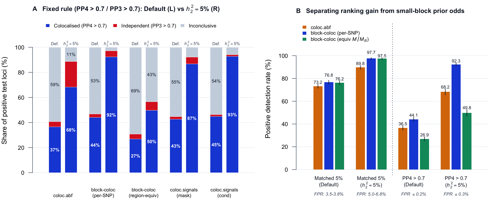

# Figure 5: Fixed Three-Way Calling Rule and Block-Prior Sensitivity



**图 5. 固定三分类判定规则（$$\mathrm{PP4} > 0.7$$ / $$\mathrm{PP3} > 0.7$$）与块内先验设定的比较（测试窗口）.** **A** 固定三分类规则下五种方法在共定位阳性位点上的判决构成（左柱：默认设定，$$n = 2{,}400$$；右柱：强 eQTL $$h^2_2 = 5.0\%$$，$$n = 1{,}200$$）。**B** 同一批阳性位点在“匹配 5% 误报率”与“固定规则 $$\mathrm{PP4} > 0.7$$”两准则下，全区域 `coloc.abf`、`block-coloc`（每 SNP 先验）与 `block-coloc`（区域等价块先验 $$M/M_B$$）的检出率及对应组内双性状独立阴性误报率范围，用以分离数据排序增益与小块先验赔率放大效应。

## Separating ranking gain from small-block prior leverage

由 [Method](method.md) 式 (2.3)，仅改变先验规范而在同一批测试位点上对比“校准匹配 5% 误报率”与“固定三分类阈值”两种决策规则（测试窗口，%）：

### Table 5A: Matched 5% FPR evaluation across prior specifications

| 模拟设定 | `coloc.abf` | `block-coloc`（每 SNP 先验） | `block-coloc`（区域等价先验） | `coloc.signals (mask)` | `coloc.signals (cond)` |
|---|---:|---:|---:|---:|---:|
| 默认：检出率（独立误报率） | 73.2 (3.5) | **76.8** (3.8) | 76.2 (3.6) | 78.2 (4.6) | 76.2 (3.8) |
| $$h^2_2 = 5.0\%$$：检出率（独立误报率） | 89.8 (5.0) | **97.7** (6.8) | 97.5 (6.7) | 94.8 (6.2) | 98.2 (7.5) |

### Table 5B: Fixed three-way calling ($$\mathrm{PP4} > 0.7$$ / $$\mathrm{PP3} > 0.7$$)

| 模拟设定与真实类别 | `coloc.abf` | `block-coloc`（每 SNP 先验） | `block-coloc`（区域等价先验） | `coloc.signals (mask)` | `coloc.signals (cond)` |
|---|---:|---:|---:|---:|---:|
| 默认：阳性（共定位 / 独立 / 不确定） | 36.5 / 4.1 / 59.3 | **44.1** / 2.7 / 53.2 | 26.9 / 3.9 / 69.2 | 42.6 / 2.1 / 55.3 | 44.9 / 1.5 / 53.7 |
| 默认：`single_distinct` 判独立（错判共定位） | 35.7 (0.2) | 35.5 (0.2) | 35.5 (0.2) | 27.0 (0.2) | 21.2 (0.3) |
| 默认：`double_distinct` 判独立（错判共定位） | 10.2 (0.0) | 9.8 (0.2) | 10.3 (0.0) | 4.7 (0.0) | 2.5 (0.0) |
| $$h^2_2 = 5.0\%$$：阳性（共定位 / 独立 / 不确定） | 68.2 / 20.4 / 11.3 | **92.3** / 4.8 / 2.8 | 49.8 / 6.8 / 43.4 | 86.8 / 5.4 / 7.8 | 92.8 / 1.3 / 5.9 |
| $$h^2_2 = 5.0\%$$：`single_distinct` 判独立（错判共定位） | 100.0 (0.0) | 98.3 (0.3) | 98.3 (0.0) | 70.7 (0.3) | 47.7 (1.3) |
| $$h^2_2 = 5.0\%$$：`double_distinct` 判独立（错判共定位） | 90.0 (0.0) | 88.0 (0.0) | 88.7 (0.0) | 34.3 (0.0) | 19.0 (1.0) |

*Note.* 固定规则下 `gwas_only` 错判为共定位的比例在默认设定所有方法均为 0.2%，在 $$h^2_2 = 5.0\%$$ 设定均为 0.0%；`null_both` 在两组设定下均精确为 0.0%。

## Statistical interpretation

1. **在匹配 5% 误报率下，功效提升源于统计排序而非小块先验**：将块内先验按 $$M/M_B$$ 缩放后，$$H_1, H_2, H_4$$ 的总先验质量与全区域精确相等，而块内先验赔率 $$\Pr(H_4)/\Pr(H_3) = \frac{p_{12}}{p_1 p_2}\frac{M_B}{M(M_B - 1)}$$ 仅因有限集合因子 $$(M_B - 1)/M_B$$ 与全区域 $$\frac{p_{12}}{p_1 p_2 (M - 1)}$$ 相差约 2.3%（默认中位 $$M = 938, M_B = 42$$ 时为 1.092 对 1.067）。在此近似等价先验下，`block-coloc` 相对 `coloc.abf` 的配对增益仅由 +3.5 微移至 +3.0 个百分点（默认设定，描述性 McNemar $$p = 2\times 10^{-12}$$）及由 +7.8 微移至 +7.7 个百分点（$$h^2_2 = 5.0\%$$，$$p = 10^{-24}$$），说明排序分离度主要由局部去干扰贡献。
2. **固定阈值下的两类局部块先验效应**：在未经重新校准临界值的 $$\mathrm{PP4} > 0.7$$ 准则下，由于默认每 SNP 先验在小块（$$M_B = 42$$）内赋予更高的 $$H_4 : H_3$$ 先验赔率（约 24.4 对全区域的 1.1），每 SNP 先验版检出率高于全区域 `coloc.abf`（44.1% 对 36.5%；强 eQTL 下 92.3% 对 68.2%）的一部分增量即源于小块先验赔率放大效应。反之，区域等价先验将块内每一对异位点构型的 $$H_3$$ 先验权重按 $$(M/M_B)^2 \approx 500$$ 倍放大；高信号核心周围大量代理点组合形成的高权重异位点对（$$i \neq j$$）显著抬升 $$H_3$$ 分母，将分块位点中位 $$\mathrm{PP4}$$ 由 0.867 压低至 0.552（低于全区域的 0.716），从而使固定阈值检出率降至 26.9% 与 49.8%。
3. **固定三分类规则的实践适用边界**：在低 LD（$$\lvert r\rvert < 0.2$$）设定下，固定规则对两类独立阴性的误报率为 0.0%–0.3%（`block-coloc`）与 0.0%（`coloc.abf`），同时在 $$h^2_2 = 5.0\%$$ 时对阳性（92.3%）与双信号独立阴性（88.0%–98.3%）给出高比例明确判决（`coloc.signals (cond)` 对 51%–80% 的独立阴性判为不确定），并因固定阈值不依赖经验分布，天然不受强信号下 `gwas_only` 单性状关联第一类错误膨胀（[Supplementary](supplement.md) §2.4）影响。在解释固定规则得分时需注意，自适应块极大值统计量并不因此成为经严格校准的后验概率；若跨性状独立因果存在中等 LD（$$\lvert r\rvert \in [0.32, 0.63)$$），固定规则下 `double_distinct` 误报率为 `block-coloc` 1.8% 对全区域 `coloc.abf` 0.8%（[Supplementary](supplement.md) §1.4）。

## Reproducibility

```bash
Rscript scripts/prior_rule.R --cores 4
python3 scripts/prior_rule_eval.py --out outputs/bulk_h2ref_v1_prior --stage1 outputs/bulk_h2ref_v1
Rscript scripts/plot_main_figures.R
```
